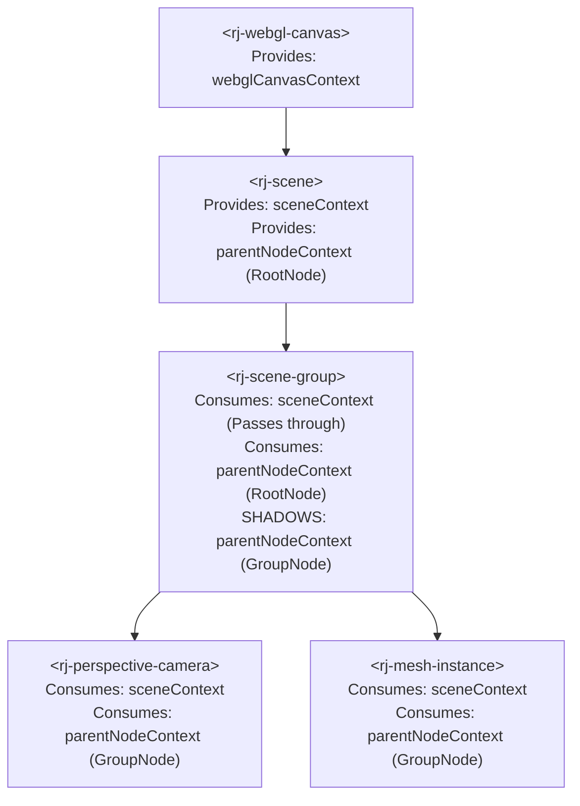

# Lit Context Architecture & Hierarchical State Guide

A comprehensive architectural and practical guide for implementing decoupled state propagation, hierarchical dependency injection, and cross-boundary communication using `@lit/context` in this codebase.

---

## 1. Overview & Architectural Role

Component hierarchies often require sharing state across multiple levels of nested elements. In traditional architectures, this leads to two common antipatterns:
- **Prop Drilling:** Passing properties down through intermediary elements that have no operational need for the data.
- **Fragile DOM Crawling:** Using imperative DOM traversals like `this.closest("rj-scene")` or `this.parentElement`, which tightly couples components to specific DOM tag names and breaks across Shadow DOM encapsulation boundaries.

Lit solves this through `@lit/context`, an implementation of the **W3C Context Community Protocol**. In this project:
- Context provides a decoupled, publish-subscribe dependency injection mechanism across arbitrary subtrees.
- Context seamlessly crosses Shadow DOM boundaries and `<slot>` projections without requiring intermediary elements to know or care about the passed data.
- Multi-tier Symbol-keyed context tokens guarantee strict pointer equality (`===`), prevent naming collisions, and prevent circular dependencies by residing in standalone `*_types.ts` files.
- Scene graph hierarchies use context shadowing to allow child nodes to bind directly to their nearest ancestor node while global engine resources pass through unaffected.

---

## 2. The W3C Context Community Protocol

The foundation of `@lit/context` is the browser's native DOM event system:

- **The `context-request` Event:**
  - When a consumer element needs a context value, it dispatches a specialized DOM event named `context-request`.
  - The event is configured with `bubbles: true` and `composed: true`, allowing it to bubble up the DOM tree and cross through Shadow DOM encapsulation boundaries and `<slot>` distribution trees.
- **Event Payload Protocol:**
  - The `context-request` event carries:
    - `context`: The unique context token identifier.
    - `callback`: A consumer-supplied callback function invoked by the provider with the requested value and an optional unsubscribe function.
    - `subscribe`: A boolean flag indicating whether the consumer wants to receive ongoing updates when the context value changes.
- **Provider Interception:**
  - A provider element higher in the DOM tree listens for `context-request` events.
  - When an event matches its provided context token, the provider halts propagation via `event.stopPropagation()` and immediately calls the consumer's callback with its current value.
  - If `subscribe: true` was requested, the provider stores the consumer callback in its internal subscription set to broadcast future mutations.
- **Zero Framework Coupling:**
  - Because the protocol relies strictly on standard DOM events, any web component or native DOM tree—regardless of whether it inherits from LitElement or is built with vanilla JavaScript—can participate as a provider or consumer.

---

## 3. Multi-Tier Symbol-Keyed Context Tokens

### Why String Keys Are Prohibited
In naive implementations, context tokens are often defined with string keys (e.g., `createContext("scene-context")`). In large production applications, this introduces severe hazards:
- **Collision Risk:** Two independent libraries or modules using identical string names collide unexpectedly.
- **Pointer Equality Ambiguity:** String matching relies on character equivalence rather than memory address reference identity.

### Symbol Identifiers in Companion Type Files
All context tokens in this codebase must be keyed by unique `Symbol()` identifiers and defined exclusively within companion `*_types.ts` files:

```ts
// scene_element_types.ts
import { createContext } from "@lit/context";
import type { IScene, ICameraRegistrar } from "./engine_types";

export interface ISceneContext {
    readonly scene: IScene;
    readonly cameraRegistrar: ICameraRegistrar;
    requestRender(): void;
}

export const sceneContext = createContext<ISceneContext>(
    Symbol("rj-scene-context")
);
```

### Architectural Benefits of Type-Separated Tokens
- **Zero Circular Dependencies:**
  - Provider elements (`SceneElement`) and consumer elements (`PerspectiveCameraElement`, `SceneGroupElement`) can both import `sceneContext` directly from `scene_element_types.ts`.
  - Neither component ever imports the other's implementation class.
- **Type-Safe Invariants:**
  - The `createContext<T>` generic binds the context token permanently to interface `T`. Any provider setting a value or consumer receiving a value is strictly validated at compile time by TypeScript.
- **Reference Equality:**
  - `Symbol("rj-scene-context") !== Symbol("rj-scene-context")`. Each token is uniquely identified in JavaScript memory by its reference pointer.

### Multi-Tier Architectural Context Stack
Our 3D WebGL Web Component architecture utilizes three primary context tiers:

- **Tier 1: WebGL Canvas Context (`webglCanvasContext`):**
  - *Provided by:* `<rj-webgl-canvas>` (`WebGLCanvasElement`).
  - *Exported from:* `webgl_canvas_element_types.ts`.
  - *Payload:* The active `WebGL2RenderingContext`, device pixel ratio, viewport resolution dimensions, and shared GPU resource cache.
  - *Descendant Reach:* Accessible to all scenes, post-processing pipelines, and diagnostic overlays.
- **Tier 2: Scene Engine Context (`sceneContext`):**
  - *Provided by:* `<rj-scene>` (`SceneElement`).
  - *Exported from:* `scene_element_types.ts`.
  - *Payload:* The root `IScene` engine instance, the active camera registrar, and the demand-driven frame subscription loop.
  - *Descendant Reach:* Accessible to all scene nodes, cameras, lights, and mesh instances inside the scene.
- **Tier 3: Parent Node Context (`parentNodeContext`):**
  - *Provided by:* `<rj-scene>` and shadowed by structural nodes (`<rj-scene-group>`, `<rj-scene-node>`).
  - *Exported from:* `scene_node_element_types.ts`.
  - *Payload:* The immediate parent `ISceneNode` instance.
  - *Descendant Reach:* Read by immediate child elements to attach themselves into the 3D transform graph.

---

## 4. Provider Implementation Patterns

Lit offers two complementary paradigms for providing context: declarative decorators and imperative controllers.

### Imperative Provider: `ContextProvider`
The `ContextProvider` class is a Lit Reactive Controller instantiated directly on the host element. It provides explicit imperative control over value updates and dynamic lifecycle management.

```ts
import { LitElement, html } from "lit";
import { ContextProvider } from "@lit/context";
import { sceneContext } from "./scene_element_types";
import type { ISceneContext } from "./scene_element_types";
import { SceneEngine } from "./engine/SceneEngine";

export class SceneElement extends LitElement {
    // 1. Instantiate the provider controller
    private readonly sceneProvider = new ContextProvider(this, {
        context: sceneContext,
        initialValue: undefined as unknown as ISceneContext,
    });

    private sceneEngine = new SceneEngine();

    public override connectedCallback(): void {
        super.connectedCallback();

        // 2. Supply or update the context payload
        this.sceneProvider.setValue({
            scene: this.sceneEngine.rootScene,
            cameraRegistrar: this.sceneEngine.cameras,
            requestRender: () => this.sceneEngine.markDirty(),
        });
    }

    public override disconnectedCallback(): void {
        this.sceneEngine.dispose();
        super.disconnectedCallback();
    }

    protected override render() {
        return html`<slot></slot>`;
    }
}
```

### Declarative Provider: `@provide` Decorator
When the context value is directly tied to a reactive property on the provider component, the `@provide()` decorator simplifies boilerplate:

```ts
import { LitElement, html } from "lit";
import { property } from "lit/decorators.js";
import { provide } from "@lit/context";
import { themeContext } from "./theme_context_types";
import type { ITheme } from "./theme_context_types";

export class ThemeProviderElement extends LitElement {
    @provide({ context: themeContext })
    @property({ attribute: false })
    public theme: ITheme = { mode: "dark", accentColor: "#4f46e5" };

    protected override render() {
        return html`<slot></slot>`;
    }
}
```

> [!NOTE]
> Mutating `this.theme` automatically triggers a re-render and broadcasts the new value to all subscribed consumers.

---

## 5. Consumer Implementation Patterns

### Declarative Consumer: `@consume` Decorator
The `@consume()` decorator automatically binds a component property to a context value:

```ts
import { LitElement, html } from "lit";
import { consume } from "@lit/context";
import { sceneContext } from "./scene_element_types";
import type { ISceneContext } from "./scene_element_types";

export class CameraControllerElement extends LitElement {
    @consume({ context: sceneContext, subscribe: true })
    public sceneContext?: ISceneContext;

    protected override render() {
        return html`<div>Active Scene: ${this.sceneContext ? "Ready" : "Searching..."}</div>`;
    }
}
```

- When `subscribe: true` is configured, changes pushed by the provider update `this.sceneContext` and automatically trigger an update via `this.requestUpdate()`.
- If `subscribe: false` (or omitted), the property is populated once upon connection and does not receive subsequent mutations.

### Imperative Consumer: `ContextConsumer`
For complex components requiring explicit side-effect coordination (such as attaching or detaching engine nodes in an imperative 3D graph), the imperative `ContextConsumer` controller is preferred because it exposes a direct callback hook:

```ts
import { LitElement, html } from "lit";
import { ContextConsumer } from "@lit/context";
import { parentNodeContext } from "./scene_node_element_types";
import type { ISceneNode } from "./scene_node_element_types";
import { SceneNode } from "./engine/SceneNode";

export class SceneGroupElement extends LitElement {
    public readonly node = new SceneNode();

    private currentParent: ISceneNode | null = null;

    // Imperative consumer controller with reactive subscription callback
    private readonly parentConsumer = new ContextConsumer(this, {
        context: parentNodeContext,
        subscribe: true,
        callback: (newParent) => this.handleParentNodeChange(newParent),
    });

    private handleParentNodeChange(newParent: ISceneNode | undefined): void {
        // Detach from previous parent if it existed
        if (this.currentParent && this.currentParent !== newParent) {
            this.currentParent.removeChild(this.node);
            this.currentParent = null;
        }

        // Attach to new parent
        if (newParent) {
            newParent.addChild(this.node);
            this.currentParent = newParent;
        }
    }

    public override disconnectedCallback(): void {
        if (this.currentParent) {
            this.currentParent.removeChild(this.node);
            this.currentParent = null;
        }
        super.disconnectedCallback();
    }

    protected override render() {
        return html`<slot></slot>`;
    }
}
```

---

## 6. Context Shadowing for Hierarchical Graphs

Context shadowing is a foundational architectural pattern for building hierarchical trees (such as 3D scene graphs, form validation groups, or nested modal contexts).

### How Shadowing Works
- When a `context-request` event bubbles up the DOM, the **first matching provider** along the ancestor path halts the event and provides its value.
- Intermediary providers "shadow" higher-level providers for that specific context token without disrupting other distinct context tokens.

### Implementation: The Nested Scene Graph Hierarchy
In our WebGL scene graph:
1. `<rj-scene>` provides `sceneContext` (root engine) AND `parentNodeContext` (pointing to the root scene node).
2. `<rj-scene-group>` consumes `parentNodeContext` to attach itself to the parent, but ALSO provides `parentNodeContext` initialized to its own internal node for its children.
3. `<rj-perspective-camera>` or nested child groups consume `parentNodeContext`, automatically attaching to their immediate parent `<rj-scene-group>`, rather than the root scene.
4. Throughout this hierarchy, `sceneContext` passes completely uninhibited down to every descendant.



### Complete Code Pattern for Shadowing Node

```ts
export class SceneGroupElement extends LitElement {
    public readonly node = new SceneNode();

    // 1. Consume immediate parent node from ancestor
    private readonly parentConsumer = new ContextConsumer(this, {
        context: parentNodeContext,
        subscribe: true,
        callback: (parent) => {
            if (parent) {
                parent.addChild(this.node);
            }
        },
    });

    // 2. Provide own node as parentNodeContext for child subtrees
    private readonly childProvider = new ContextProvider(this, {
        context: parentNodeContext,
        initialValue: this.node,
    });

    protected override createRenderRoot(): HTMLElement {
        // Light DOM: simplifies DOM traversal for 3D graphs
        return this;
    }
}
```

---

## 7. Reactivity, Dynamic Updates & Lifecycle Safety

### Dynamic Context Propagation
When a provider calls `provider.setValue(newValue)`:
- The provider iterates through all active consumer callbacks registered under that context.
- Each subscribed consumer executes its callback with the updated payload.
- If using `@consume({ subscribe: true })`, Lit automatically schedules a render pass (`requestUpdate()`).
- If using imperative `ContextConsumer`, the custom callback is invoked immediately, allowing imperative state synchronization before render.

### Lifecycle Timing Rules
- **Constructor:** Context is NOT available. The component is not yet in the DOM; `context-request` cannot bubble.
- **`connectedCallback()`:** The element is attached to the DOM. Context request events are dispatched automatically during this phase by `@consume` and `ContextConsumer`.
- **`firstUpdated()`:** Initial context values have arrived and initial rendering has completed. Safe for first-time DOM and context coordination.
- **Handling Disconnections (`disconnectedCallback()`):**
  - Always clean up event subscriptions and detach imperative references.
  - Providers automatically clear dangling subscriptions when consumers disconnect from the DOM and fire unsubscribe handlers.

> [!WARNING]
> When moving or reparenting elements in the DOM, an element will disconnect and reconnect. Imperative callbacks must gracefully handle `undefined` or `null` values during transitions to prevent memory leaks and dangling node references.

---

## 8. Testing Context Providers & Consumers

Testing context interactions in unit tests requires verifying both initial resolution and dynamic updates without instantiating complex full-application trees.

### Testing a Consumer in Isolation
To test a consumer without creating its real parent provider, mount a minimal test harness or use `ContextProvider` on a test container element:

```ts
import { describe, it, expect, beforeEach, afterEach } from "vitest";
import { LitElement, html } from "lit";
import { ContextProvider } from "@lit/context";
import { parentNodeContext } from "./scene_node_element_types";
import { SceneGroupElement } from "./scene_group_element";
import { SceneNode } from "./engine/SceneNode";

describe("SceneGroupElement Context Integration", () => {
    let container: HTMLDivElement;
    let mockParentNode: SceneNode;
    let provider: ContextProvider<typeof parentNodeContext>;

    beforeEach(() => {
        container = document.createElement("div");
        mockParentNode = new SceneNode();

        // Attach provider to test container
        provider = new ContextProvider(container, {
            context: parentNodeContext,
            initialValue: mockParentNode,
        });

        document.body.appendChild(container);
    });

    afterEach(() => {
        container.remove();
    });

    it("attaches internal node to provided parent on mount", async () => {
        const groupEl = document.createElement("rj-scene-group") as SceneGroupElement;
        container.appendChild(groupEl);

        await groupEl.updateComplete;

        expect(mockParentNode.children).toContain(groupEl.node);
    });

    it("updates attachment when context value updates dynamically", async () => {
        const groupEl = document.createElement("rj-scene-group") as SceneGroupElement;
        container.appendChild(groupEl);
        await groupEl.updateComplete;

        const newParentNode = new SceneNode();
        provider.setValue(newParentNode);

        expect(mockParentNode.children).not.toContain(groupEl.node);
        expect(newParentNode.children).toContain(groupEl.node);
    });
});
```

---

## 9. Architectural Rules & Best Practices

- **Companion Types File Mandate:**
  - Context tokens must NEVER be declared in an element implementation file (`*_element.ts`).
  - Declare tokens in `*_types.ts` alongside their payload interfaces.
- **Unique Symbols:**
  - Always use `createContext<T>(Symbol("unique-token-name"))`. Never use raw string keys.
- **Explicit Subscriptions:**
  - Configure `subscribe: true` on consumers only when the context payload is expected to mutate over time (e.g., active camera changes, viewport resize). For static one-time injection, use `subscribe: false` to conserve listener overhead.
- **Idempotent Cleanup:**
  - Components consuming context to register with an external engine or parent node must detach cleanly in `disconnectedCallback()` and re-attach cleanly in `connectedCallback()`.
- **Light DOM Compatibility:**
  - Lit context works identically in both Shadow DOM and Light DOM. Structural scene elements (`<rj-scene>`, `<rj-scene-group>`) use Light DOM to facilitate natural DOM inspection and hierarchy traversal while still relying on context for reliable state propagation.
