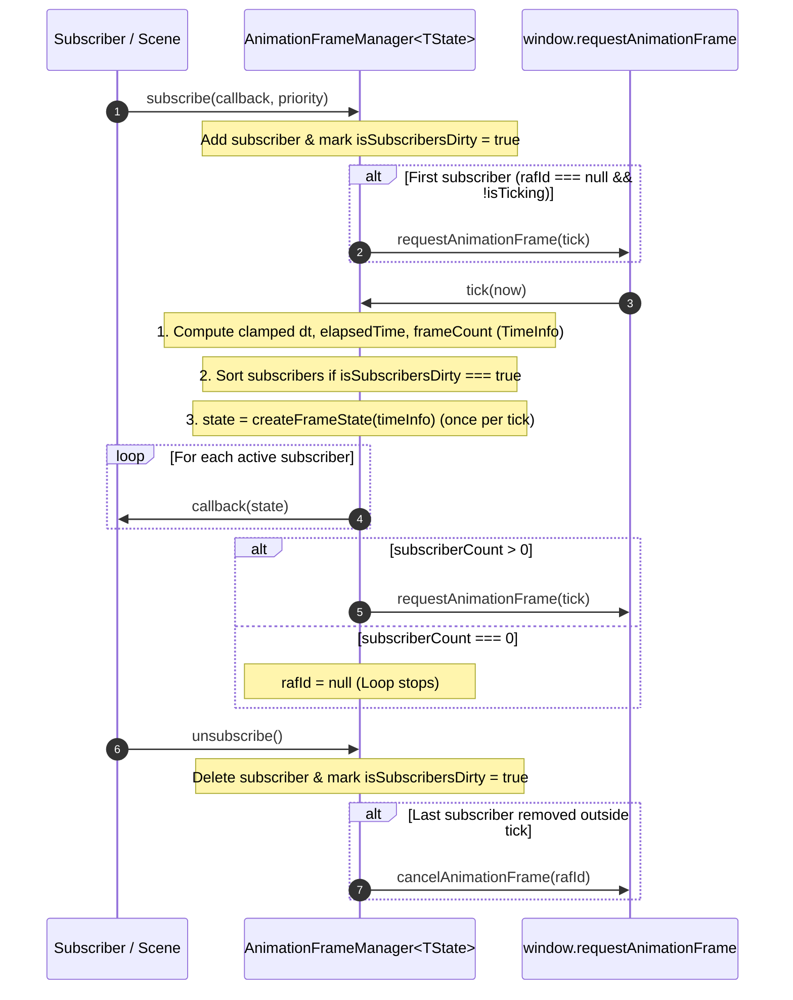

# Generic AnimationFrameManager Design

## 1. Overview & Design Goals

### Purpose
`AnimationFrameManager<TState extends AnimationFrameState = AnimationFrameState>` is a demand-driven, priority-ordered `requestAnimationFrame` scheduler and simulation clock. It encapsulates subscriber registration, priority sorting, monotonic frame timing, delta-time clamping, and mid-tick unsubscription safety so that host containers (such as [`Scene`](scene.ts)) can expose frame loops without duplicating `requestAnimationFrame` bookkeeping.

### Key Architectural Principles
- **Base `AnimationFrameState` Guarantee (`TState extends AnimationFrameState = AnimationFrameState`):**
  - Every frame state payload is guaranteed at the type level to include `readonly timeInfo: TimeInfo` (`{ time, dt, frameCount }`).
  - Callers supply a required `createFrameState: (timeInfo: TimeInfo) => TState` factory in the constructor (e.g., `(timeInfo) => ({ timeInfo })` for the base `AnimationFrameState`, or `(timeInfo) => ({ scene: this, activeCamera: this.activeCamera, timeInfo })` in [`Scene`](scene.ts)).
  - Making `createFrameState` required eliminates all unsafe `as unknown as TState` type assertions and guarantees at compile time that `TState` is always constructed with all required fields. The manager invokes `createFrameState(timeInfo)` **once per tick** and dispatches the resulting `TState` payload to all subscribers without allocating per-subscriber wrapper closures.
- **Demand-Driven Activation (Zero Idle Overhead):**
  - No `requestAnimationFrame` handle is scheduled upon instantiation when zero subscribers exist.
  - The RAF loop starts automatically when the first subscriber registers (`subscriberCount` transitions from `0` to `1`) and cancels immediately via `cancelAnimationFrame` when the last subscriber unsubscribes (`subscriberCount` drops to `0`).
- **Priority-Ordered Execution with Dirty-Flag Caching:**
  - Subscribers specify an optional numerical `priority` (default `0`, lower values execute first).
  - The sorted subscriber array is rebuilt only when `isSubscribersDirty` is set (on subscribe or unsubscribe), avoiding per-frame array allocations or sorts during steady-state execution.
- **Clamped Monotonic Simulation Clock:**
  - Raw frame delta `(now - lastTime) / 1000` is clamped to `[MIN_SIMULATION_DT_SEC, MAX_SIMULATION_DT_SEC]` (`[0.0001, 0.1]` seconds) to prevent zero/negative deltas or large physics spikes after browser tab switches.
- **Mid-Tick Unsubscription Safety:**
  - If a subscriber unsubscribes itself or a downstream subscriber during a tick, downstream unsubscribed callbacks are skipped immediately and no follow-up RAF is scheduled if `subscriberCount` reaches `0`.
- **Strict Separation of Types & Constants:**
  - Types reside in [`animation_frame_manager_types.ts`](animation_frame_manager_types.ts), constants in [`animation_frame_manager_constants.ts`](animation_frame_manager_constants.ts), and the class implementation in [`animation_frame_manager.ts`](animation_frame_manager.ts).

---

## 2. Module Layout & Responsibilities

- **[`src/scene/core/animation_frame_manager_constants.ts`](animation_frame_manager_constants.ts)**:
  - `DEFAULT_FRAME_SUBSCRIBER_PRIORITY = 0`
  - `MS_PER_SECOND = 1000`
  - `MIN_SIMULATION_DT_SEC = 0.0001`
  - `MAX_SIMULATION_DT_SEC = 0.1`
- **[`src/scene/core/animation_frame_manager_types.ts`](animation_frame_manager_types.ts)**:
  - Generic type contracts (`AnimationFrameState`, `AnimationFrameCallback<TState>`, `AnimationFrameStateFactory<TState>`, `AnimationFrameSubscriber<TState>`, `IAnimationFrameManager<TState>`).
- **[`src/scene/core/animation_frame_manager.ts`](animation_frame_manager.ts)**:
  - Concrete `AnimationFrameManager<TState extends AnimationFrameState = AnimationFrameState>` implementation.

---

## 3. API & Type Specifications (`animation_frame_manager_types.ts`)

```typescript
import type { TimeInfo } from "../../webgl/canvas/canvas_types";

/**
 * Opaque numeric handle identifying a scheduled requestAnimationFrame callback.
 */
export type AnimationFrameHandle = number;

/**
 * High-resolution monotonic timestamp or duration in milliseconds (DOMHighResTimeStamp).
 */
export type Milliseconds = number;

/**
 * Browser requestAnimationFrame callback receiving the current monotonic timestamp in milliseconds.
 */
export type AnimationFrameRequestCallback = (timestampMs: Milliseconds) => void;

/**
 * Injectable timing and animation frame scheduling provider.
 */
export interface IAnimationFrameScheduler {
    /** Schedules a callback for the next animation frame and returns its handle */
    readonly requestAnimationFrame: (callback: AnimationFrameRequestCallback) => AnimationFrameHandle;
    /** Cancels a previously scheduled animation frame callback by its handle */
    readonly cancelAnimationFrame: (handle: AnimationFrameHandle) => void;
    /** Returns the current monotonic timestamp in milliseconds (e.g., performance.now()) */
    readonly getTimestampMs: () => Milliseconds;
}

/**
 * Base frame state guaranteed to be delivered to every AnimationFrameManager subscriber.
 */
export interface AnimationFrameState {
    /** Simulation timing metrics (elapsed seconds, clamped delta seconds, tick count) */
    readonly timeInfo: TimeInfo;
}

/**
 * Callback invoked on each tick of the AnimationFrameManager loop.
 */
export type AnimationFrameCallback<
    TState extends AnimationFrameState = AnimationFrameState
> = (state: TState) => void;

/**
 * Factory function invoked once per tick to construct the frame state payload from TimeInfo.
 */
export type AnimationFrameStateFactory<
    TState extends AnimationFrameState = AnimationFrameState
> = (timeInfo: TimeInfo) => TState;

/**
 * Internal subscriber record managed by AnimationFrameManager.
 */
export interface AnimationFrameSubscriber<
    TState extends AnimationFrameState = AnimationFrameState
> {
    readonly id: string;
    readonly priority: number;
    readonly callback: AnimationFrameCallback<TState>;
}

/**
 * Demand-driven, priority-ordered requestAnimationFrame loop manager.
 */
export interface IAnimationFrameManager<
    TState extends AnimationFrameState = AnimationFrameState
> {
    /** Number of currently active subscribers */
    readonly subscriberCount: number;

    /** Whether a requestAnimationFrame tick is currently scheduled or executing */
    readonly isRunning: boolean;

    /**
     * Registers a frame callback at the given priority (lower numbers run first; default: 0).
     * Starts the RAF loop if not already running. Returns an unsubscribe cleanup closure.
     */
    subscribe(callback: AnimationFrameCallback<TState>, priority?: number): () => void;

    /**
     * Cancels any pending requestAnimationFrame and clears all subscribers.
     */
    destroy(): void;
}
```

---

## 4. Specialization in `Scene` (`src/scene/core/scene.ts`)

[`Scene`](scene.ts) specializes `AnimationFrameManager<SceneFrameState>` by supplying a state factory and optional `IAnimationFrameScheduler` in its constructor:

```typescript
private readonly _frameManager: AnimationFrameManager<SceneFrameState>;

constructor(
    name: string = "SceneRoot",
    id?: string,
    scheduler?: IAnimationFrameScheduler
) {
    super(name, id);
    this._frameManager = new AnimationFrameManager<SceneFrameState>(
        (timeInfo) => ({
            scene: this,
            activeCamera: this.activeCamera,
            timeInfo,
        }),
        scheduler
    );
}
}

public subscribeFrame(
    callback: SceneFrameCallback,
    priority: number = DEFAULT_FRAME_SUBSCRIBER_PRIORITY
): () => void {
    return this._frameManager.subscribe(callback, priority);
}
```

When `scene.destroy()` is invoked, `this._frameManager.destroy()` cancels any pending `requestAnimationFrame` and clears all subscribers.

---

## 5. Lifecycle & Execution Flow


