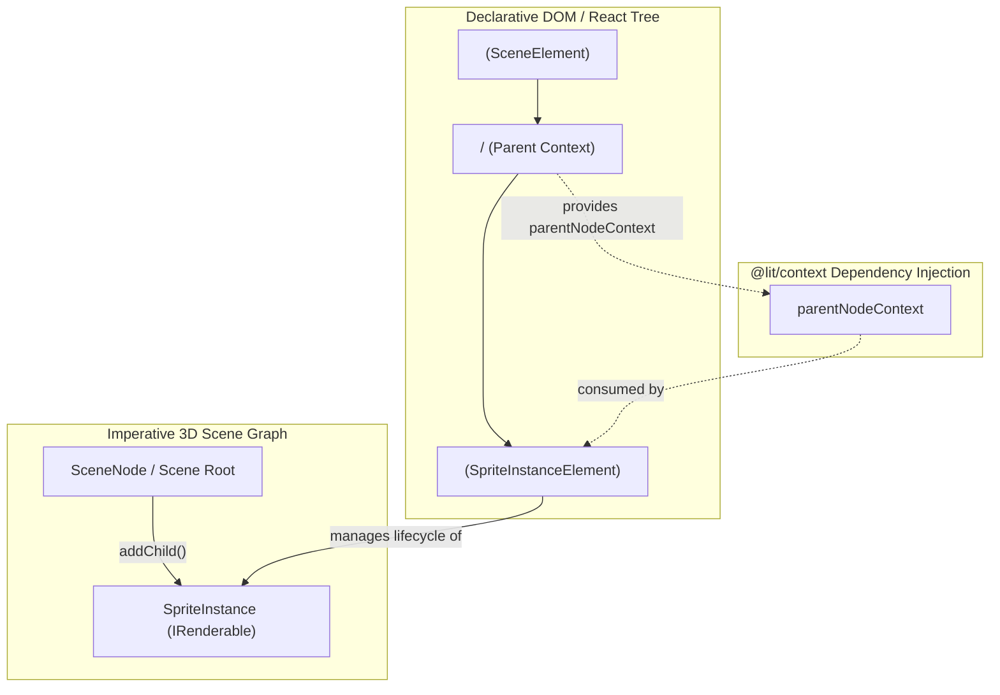

# Sprite Instance Web Component Design (`<rj-sprite-instance>`)

## 1. Executive Summary & Design Goals

### Overview
This document specifies the architectural design for the declarative Lit Web Component wrapper **`<rj-sprite-instance>`** (`SpriteInstanceElement`). It bridges the imperative, pure-engine [`SpriteInstance`](../sprites/sprite_instance.ts) subsystem into the declarative HTML and React DOM tree, mirroring the proven architecture of [`ModelInstanceElement`](model_instance_element.ts) (`<rj-model-instance>`).

The primary goal is enabling developers to declare camera-facing billboard markers, waypoints, reticles, and celestial pins directly within `<rj-scene>` markup in React and Lit without writing imperative scene graph code.

### Key Architectural Principles
- **Declarative Web Component Bridge:** Extends `LitElement` and manages the lifecycle of an internal [`SpriteInstance`](../sprites/sprite_instance.ts), synchronizing properties across the DOM and WebGL scene graph.
- **Strict Lit Guidelines Compliance:** Adheres to [lit_guidelines.md](../../project_guidelines/lit_guidelines.md) using decoratorless static properties (`public static override properties = { ... }`), side-effect-free module imports, and a flag-guarded idempotent setup function (`setupSpriteInstanceElement()`).
- **Context-Driven Hierarchy Integration:** Consumes [`parentNodeContext`](scene_element_types.ts) from parent nodes or [`<rj-scene>`](scene_element.ts) via `@lit/context`, attaching the underlying `SpriteInstance` into the active scene graph, while providing itself as a parent context for any nested child elements.
- **Light DOM Rendering:** Renders into the Light DOM (`createRenderRoot() { return this; }`) to allow child elements to attach transparently without Shadow DOM encapsulation barriers.
- **Strict Vector & Color Standards:** Adheres to [working_with_vectors_and_colors_guidelines.md](../../project_guidelines/working_with_vectors_and_colors_guidelines.md), accepting explicit semantic interfaces ([`Vector3Like`](../../maths/vector_types.ts), [`Vector2Like`](../../maths/vector_types.ts)) and converting attribute strings via [`vector3Converter`](../../lit/converters/vector3_converter.ts).
- **TypeScript & React JSX Augmentation:** Augments `HTMLElementTagNameMap` and React's `JSX.IntrinsicElements` for seamless compile-time typing and autocompletion.

---

## 2. Component Hierarchy & Flow



---

## 3. Element API & Properties

The component is registered under tag name `rj-sprite-instance`.

### Property Specifications
- **`name`** (`string`, attribute: `"name"`, reflect: true)
  - Node identifier for debugging and scene graph traversal. Default: `"SpriteInstance"`.
- **`position`** ([`Vector3Like`](../../maths/vector_types.ts), converter: `vector3Converter`, reflect: true)
  - 3D world translation coordinates $\{ x, y, z \}$. Default: $\{ x: 0, y: 0, z: 0 \}$.
- **`rotation`** ([`Vector3Like`](../../maths/vector_types.ts), converter: `vector3Converter`, reflect: true)
  - 3D Euler angles in radians $\{ x, y, z \}$. Default: $\{ x: 0, y: 0, z: 0 \}$.
- **`scale`** ([`Vector3Like`](../../maths/vector_types.ts), converter: `vector3Converter`, reflect: true)
  - 3D scaling factors $\{ x, y, z \}$. Default: $\{ x: 1, y: 1, z: 1 \}$.
- **`visible`** (`boolean`, attribute: `"visible"`, type: Boolean, reflect: true)
  - Visibility toggle. Default: `true`.
- **`renderOrder`** (`number`, attribute: `"render-order"`, type: Number, reflect: true)
  - Explicit rendering queue order. Default: `1000` (or `5000` when material has `alwaysOnTop: true`).
- **`anchor`** ([`Vector2Like`](../../maths/vector_types.ts), attribute: false)
  - Normalized 2D anchor pivot $\{ x, y \}$. For pins, defaults to $\{ x: 0.5, y: 0.0 \}$ (bottom tip).
- **`size`** ([`Vector2Like`](../../maths/vector_types.ts), attribute: false)
  - Dimensions $\{ x: \text{width}, y: \text{height} \}$ in pixels or world units. Default: $\{ x: 32, y: 32 \}$.
- **`sizeMode`** ([`SpriteSizeMode`](../sprites/sprite_instance_types.ts), attribute: `"size-mode"`, type: Number, reflect: true)
  - Active sizing paradigm: `ScreenSpace = 0`, `WorldSpace = 1`, `ClampedScreenSpace = 2`. Default: `ScreenSpace`.
- **`sizeClamping`** ([`SpriteSizeClamping`](../sprites/sprite_instance_types.ts), attribute: false)
  - Min/max pixel bounds when using `ClampedScreenSpace`.
- **`billboardMode`** ([`BillboardMode`](../sprites/sprite_instance_types.ts), attribute: `"billboard-mode"`, type: Number, reflect: true)
  - Rotation behavior: `Spherical = 0`, `Cylindrical = 1`. Default: `Spherical`.
- **`material`** ([`ISpriteMaterial`](../sprites/sprite_material_types.ts), attribute: false)
  - The appearance material instance (e.g. `SpritePinMaterial` or `SpriteTextureMaterial`).

### Public Element Methods & Accessors
- **`get spriteInstance(): SpriteInstance`**
  - Direct access to the underlying programmatic [`SpriteInstance`](../sprites/sprite_instance.ts).
- **`get node(): SpriteInstance`**
  - Standard polymorphic accessor satisfying the [`ISceneNode`](../core/scene_node_types.ts) bridge protocol.

---

## 4. Lifecycle & Synchronization Mechanics

### 1. Construction & Initialization
- Instantiates a private `_spriteInstance: SpriteInstance` with default anchor, size, and placeholder material.
- Initializes a `ContextConsumer` subscribing to `parentNodeContext`.
- Initializes a `ContextProvider` providing `parentNodeContext` initialized to `_spriteInstance`.

### 2. Parent Attachment (`connectedCallback` & `_handleParentNode`)
- In `connectedCallback()`, updates the parent context provider value.
- When `parentNodeContext` resolves from an ancestor element (`<rj-scene>` or `<rj-node-3d>`):
  1. Detaches `_spriteInstance` from any previous parent node (`oldParent.removeChild(_spriteInstance)`).
  2. Attaches `_spriteInstance` to the new parent node (`newParent.addChild(_spriteInstance)`).
  3. Caches `_currentParent`.

### 3. Detachment & Cleanup (`disconnectedCallback`)
- When the element is removed from DOM:
  1. Detaches `_spriteInstance` from `_currentParent`.
  2. Clears internal parent references.
  3. Does **not** dispose shared quad geometry.

### 4. Property Synchronization (`willUpdate`)
In Lit's `willUpdate(changedProperties)`:
- If `name` changed: `_spriteInstance.name = this.name`.
- If `position` changed: `_spriteInstance.transform.setPosition(position.x, position.y, position.z)`.
- If `rotation` changed: `_spriteInstance.transform.setRotationEuler(rotation.x, rotation.y, rotation.z)`.
- If `scale` changed: `_spriteInstance.transform.setScale(scale.x, scale.y, scale.z)`.
- If `visible` changed: `_spriteInstance.visible = this.visible`.
- If `renderOrder` changed: `_spriteInstance.renderOrder = this.renderOrder`.
- If `anchor` changed: `_spriteInstance.setAnchor(this.anchor)`.
- If `size` changed: `_spriteInstance.setSize(this.size)`.
- If `sizeMode` changed: `_spriteInstance.sizeMode = this.sizeMode`.
- If `sizeClamping` changed: `_spriteInstance.sizeClamping = this.sizeClamping`.
- If `billboardMode` changed: `_spriteInstance.billboardMode = this.billboardMode`.
- If `material` changed: `_spriteInstance.material = this.material`.

---

## 5. TypeScript Interface Specifications

### Module: `src/scene/elements/sprite_instance_element_types.ts`

```typescript
import type { Vector3Like, Vector2Like } from "../../maths/vector_types";
import type { ISpriteMaterial } from "../sprites/sprite_material_types";
import type { BillboardMode, SpriteSizeMode, SpriteSizeClamping } from "../sprites/sprite_instance_types";
import type { SpriteInstanceElement } from "./sprite_instance_element";

/**
 * Declarative property inputs for sprite instance elements (<rj-sprite-instance>).
 */
export interface SpriteInstanceElementProps {
    name?: string;
    position?: Vector3Like;
    rotation?: Vector3Like;
    scale?: Vector3Like;
    visible?: boolean;
    renderOrder?: number;
    anchor?: Vector2Like;
    size?: Vector2Like;
    sizeMode?: SpriteSizeMode;
    sizeClamping?: SpriteSizeClamping;
    billboardMode?: BillboardMode;
    material?: ISpriteMaterial;
}

declare global {
    interface HTMLElementTagNameMap {
        "rj-sprite-instance": SpriteInstanceElement;
    }
}
```

### Module: `src/scene/elements/sprite_instance_element_constants.ts`

```typescript
export const TAG_RJ_SPRITE_INSTANCE = "rj-sprite-instance";
export const DEFAULT_SPRITE_INSTANCE_ELEMENT_NAME = "SpriteInstance";
export const DEFAULT_SPRITE_INSTANCE_VISIBLE = true;
```

---

## 6. Implementation Checklist & Phased Roadmap

- **Phase 1: Feature Code Implementation**
  - Author `sprite_instance_element_types.ts` and `sprite_instance_element_constants.ts`.
  - Author `sprite_instance_element.ts` implementing `SpriteInstanceElement` with decoratorless static properties.
  - Update `setup_scene_elements.ts` to register `TAG_RJ_SPRITE_INSTANCE`.
  - Update `jsx_types.ts` to add `"rj-sprite-instance"` to React JSX IntrinsicElements.
- **Phase 2: Architecture Review & Audit**
  - Verify static properties, light DOM, context binding, and zero magic numbers.
- **Phase 3: Independent Unit Test Authoring**
  - Author `src/scene/elements/sprite_instance_element.test.ts` adhering to [making_lit_unit_tests_guidelines.md](../../project_guidelines/making_lit_unit_tests_guidelines.md).
- **Phase 4: Quality Gate & Verification**
  - Execute `npm test` and `npm run build`.
- **Phase 5: Galaxy Scene Visual Verification**
  - Add `<rj-sprite-instance>` center pin to `src/galaxy_backdrop/galaxy_scene.tsx` for immediate visual testing.
