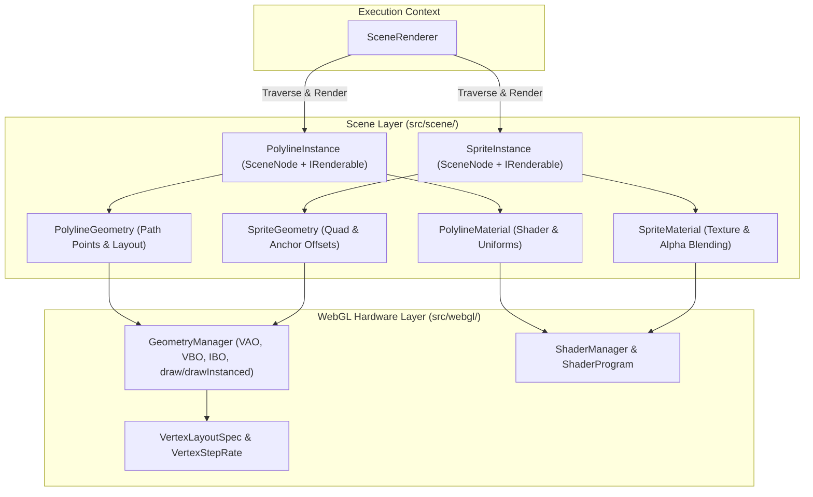

# Polyline Route & Billboard Waypoint System Design

## 1. Executive Summary & Design Goals

### Overview
This document specifies the architectural design for two new renderable citizens in the 3D scene engine:
- **`PolylineInstance`:** A renderable entity that draws a continuous, styled 3D path (polyline) connecting an ordered sequence of spatial points $[P_0, P_1, \ldots, P_{N-1}]$. Its primary application is rendering a GPS-style navigational route winding through a 3D galaxy of stars (e.g. glowing blue transit lanes, warp corridors, or trajectory paths).
- **`SpriteInstance`:** A camera-facing billboarded entity used for 2D/3D visual markers, specifically waypoint indicators such as "Red Pins" denoting the start, end, and intermediate points of interest along the route.

### Key Architectural Principles
- **Constant Screen-Space Legibility:** A navigation route and its waypoint pins must remain legible and crisp regardless of camera distance—whether inspecting an individual star system up close or zooming out to view the entire galactic disc.
- **Pure Scene Graph Citizens:** Both `PolylineInstance` and `SpriteInstance` extend [`SceneNode`](../core/scene_node.ts) and implement [`IRenderable`](../core/renderable_types.ts). They integrate seamlessly into the scene graph, participate in parent-child spatial hierarchy, and are consumed by [`SceneRenderer`](../renderer/scene_renderer.ts) without special-case branching.
- **Strict Separation of Types from Implementation:** All interfaces and data contracts reside in dedicated `*_types.ts` files.
- **Decoupled WebGL Subsystem Layering:** High-level scene representations (nodes, materials, path curves) live in `src/scene/`, while hardware-level buffer allocations, vertex attribute schemas, and instanced draw calls live in `src/webgl/`.
- **No Backward Compatibility Aliases:** Clean, direct implementations with no obsolete wrappers or deprecated methods.
- **Zero Magic Numbers:** All default widths, thresholds, miter limits, and blend presets are exported as typed constants.

---

## 2. Directory Layout & Subsystem Separation

To maintain modularity and avoid monolithic files, components are distributed between the high-level scene engine and the low-level WebGL graphics abstraction:



### Proposed Directory Structure

- **Scene Layer (`src/scene/`):**
  - **`src/scene/lines/`:**
    - `polyline_route_system_design.md` (This document)
    - [`polyline_shader_design.md`](polyline_shader_design.md): Sub-design for screen-space ribbon extrusion shader and miter math.
    - `polyline_instance_types.ts`: Interface definitions for `IPolylineInstance`, configurations, and render modes.
    - `polyline_instance.ts`: `PolylineInstance` class extending `SceneNode` and implementing `IRenderable`.
    - `polyline_geometry_types.ts`: Path point data types, join styles (`Miter`, `Bevel`, `Round`), and cap styles.
    - `polyline_geometry.ts`: `PolylineGeometry` managing CPU buffers and line point mutations.
  - **`src/scene/sprites/`:**
    - [`sprite_instance_design.md`](../sprites/sprite_instance_design.md): Sub-design for billboard sprites and pins.
    - `sprite_instance_types.ts`: Interface definitions for `ISpriteInstance`, billboard modes, and anchor configurations.
    - `sprite_instance.ts`: `SpriteInstance` class extending `SceneNode` and implementing `IRenderable`.
    - `sprite_geometry.ts` & `sprite_geometry_types.ts`: Unit quad geometry with configurable anchor point offsets.
  - **`src/scene/materials/`:**
    - `polyline_material.ts` & `polyline_material_types.ts`: Polyline shader bindings, line width, glow, dash, and color uniforms.
    - `sprite_material.ts` & `sprite_material_types.ts`: Sprite texture, tint, opacity, and alpha-testing properties.
  - **`src/scene/shaders/`:**
    - `polyline_ribbon.vert` & `polyline_ribbon.frag`: Strategy 2 screen-space ribbon extrusion shader.
    - `polyline_instanced.vert` & `polyline_instanced.frag`: Strategy 3 instanced segment shader.
    - `sprite_billboard.vert` & `sprite_billboard.frag`: Camera-aligned billboard sprite shader.

- **WebGL Hardware Layer (`src/webgl/`):**
  - **`src/webgl/geometry/`:**
    - `geometry_manager.ts` update: Add `drawInstanced(geometry, instanceCount)` support for instanced draws (required for Strategy 3 and batched waypoint sprites).
  - **`src/webgl/lines/` (optional WebGL-specific helpers):**
    - `polyline_vertex_layouts.ts`: Predefined `VertexLayoutSpec` definitions for polyline ribbon attributes and segment instances.

---

## 3. Strategy 2: Screen-Space Billboarded Ribbons (Extruded Polylines)

### Core Concept
In Strategy 2, the CPU submits an ordered list of 3D vertices representing the path. The GPU vertex shader is responsible for dynamically expanding the 1D path into a 2D screen-facing polygonal ribbon with a constant or scaled pixel width.

```
       Segment Normal N
             ^
  v1 +-------+-------+ v3  <-- Ribbon Edge (+width/2)
     |       |       |
  P0 o=======o=======o P2  <-- Centerline Path
     |       |       |
  v0 +-------+-------+ v2  <-- Ribbon Edge (-width/2)
```

### Vertex Layout & Attribute Encoding
To compute screen-space tangents and normals at each waypoint without storing full triangle strips on CPU, each vertex in the buffer is duplicated (one for the top edge, one for the bottom edge) and carries neighborhood context:

- **Attribute 0 (`a_currentPosition`, `vec3`):** The 3D coordinates of the current waypoint $P_i$.
- **Attribute 1 (`a_previousPosition`, `vec3`):** The 3D coordinates of the preceding waypoint $P_{i-1}$ (or $P_i$ at the start).
- **Attribute 2 (`a_nextPosition`, `vec3`):** The 3D coordinates of the subsequent waypoint $P_{i+1}$ (or $P_i$ at the end).
- **Attribute 3 (`a_sideAndProgress`, `vec2`):**
  - `side` ($\pm 1.0$): Determines whether the vertex extrudes along the positive or negative normal.
  - `progress` ($u \in [0, 1]$ or distance along line): Enables dash animations, travel pulses, and color gradients.

### Screen-Space Extrusion Algorithm
1. **Transform to Clip Space:**
   $$\mathbf{c}_{\text{curr}} = \mathbf{P} \times \mathbf{V} \times \mathbf{M} \times \begin{bmatrix} P_{\text{curr}} \\ 1 \end{bmatrix}$$
   $$\mathbf{c}_{\text{prev}} = \mathbf{P} \times \mathbf{V} \times \mathbf{M} \times \begin{bmatrix} P_{\text{prev}} \\ 1 \end{bmatrix}, \quad \mathbf{c}_{\text{next}} = \mathbf{P} \times \mathbf{V} \times \mathbf{M} \times \begin{bmatrix} P_{\text{next}} \\ 1 \end{bmatrix}$$

2. **Project to Normalized Device Coordinates (NDC) & Screen Pixels:**
   $$\mathbf{s}_{\text{curr}} = \left( \frac{\mathbf{c}_{\text{curr}}.xy}{\mathbf{c}_{\text{curr}}.w} \right) \times \frac{\text{viewportResolution}}{2}$$

3. **Compute 2D Tangents & Normals:**
   $$\mathbf{T}_{\text{in}} = \text{normalize}(\mathbf{s}_{\text{curr}} - \mathbf{s}_{\text{prev}}), \quad \mathbf{T}_{\text{out}} = \text{normalize}(\mathbf{s}_{\text{next}} - \mathbf{s}_{\text{curr}})$$
   $$\mathbf{N}_{\text{in}} = \begin{bmatrix} -\mathbf{T}_{\text{in}}.y \\ \mathbf{T}_{\text{in}}.x \end{bmatrix}, \quad \mathbf{N}_{\text{out}} = \begin{bmatrix} -\mathbf{T}_{\text{out}}.y \\ \mathbf{T}_{\text{out}}.x \end{bmatrix}$$

4. **Compute Miter Normal & Length:**
   The miter tangent is the sum of the inward and outward normals:
   $$\mathbf{N}_{\text{miter}} = \text{normalize}(\mathbf{N}_{\text{in}} + \mathbf{N}_{\text{out}})$$
   $$\text{miterLength} = \frac{1}{\mathbf{N}_{\text{miter}} \cdot \mathbf{N}_{\text{in}}}$$

5. **Miter Clamping (Spike Prevention):**
   If the turn angle is sharp, $\text{miterLength}$ approaches infinity, producing long unsightly spikes. If $\text{miterLength} > \text{u\_miterLimit}$ (typically $2.0 \to 3.0$), the extrusion clamps to a bevel edge.

6. **Extrude & Re-project to Clip Space:**
   $$\mathbf{offset}_{\text{pixels}} = \mathbf{N}_{\text{miter}} \times \left( \text{side} \times \frac{\text{u\_lineWidth}}{2} \times \min(\text{miterLength}, \text{u\_miterLimit}) \right)$$
   $$\mathbf{offset}_{\text{clip}} = \begin{bmatrix} \frac{2 \times \mathbf{offset}_{\text{pixels}}.x}{\text{viewportResolution}.x} \\ \frac{2 \times \mathbf{offset}_{\text{pixels}}.y}{\text{viewportResolution}.y} \end{bmatrix} \times \mathbf{c}_{\text{curr}}.w$$
   $$\mathbf{c}_{\text{final}} = \mathbf{c}_{\text{curr}} + \begin{bmatrix} \mathbf{offset}_{\text{clip}} \\ 0 \\ 0 \end{bmatrix}$$

### Fragment Shader Visual Features
- **Anti-Aliasing:** Using `side` coordinate ($\in [-1, 1]$), compute edge feathering with `smoothstep(1.0 - delta, 1.0, abs(v_side))`.
- **Neon Glow:** An exponential falloff $I(v) = \exp(-k \times v^2) + \text{coreIntensity}$ produces a vivid sci-fi route with a hot cyan/white core surrounded by an atmospheric royal-blue glow.
- **Animated Chevrons / Dashes:** Using line distance $u$ and uniform `u_time`, sample a periodic pulse `sin(u * frequency - time * speed)` to display moving directional pulses along the route.

---

## 4. Strategy 3: Instanced Segment Quads with Joint Caps

### Core Concept
In Strategy 3, the CPU breaks the polyline into individual segment pairs $(P_A, P_B)$. The GPU draws all segments in a single draw call by instancing a standard unit quad $[-0.5, 0.5] \times [0, 1]$. An optional second instanced draw call renders circular billboard discs at each vertex $P_i$ to provide seamless rounded corners.

```
          Quad Instance [P_A -> P_B]
             +-----------------+
  (Disc P_A) (                 ) (Disc P_B)
             +-----------------+
```

### Instanced Buffer Layout
- **Static Mesh Buffer (VBO 1 - Unit Quad):**
  - 4 vertices, 6 indices (2 triangles), unit coordinate $[-0.5, 0.5] \times [0, 1]$.
  - Divisor: `VertexStepRate.PerVertex` (0).
- **Instance Buffer (VBO 2 - Segment Data):**
  - Attribute 0 (`a_pointA`, `vec3`): World/model coordinate of segment start $P_A$.
  - Attribute 1 (`a_pointB`, `vec3`): World/model coordinate of segment end $P_B$.
  - Attribute 2 (`a_segmentParams`, `vec4`): `[width, startU, endU, segmentIndex]`.
  - Divisor: `VertexStepRate.PerInstance` (1).

### Vertex Shader Billboard Extrusion
For each instance, the vertex shader expands the unit quad along the segment vector $\mathbf{V} = P_B - P_A$ and bills it toward the camera:
1. Compute the segment direction $\mathbf{D} = \text{normalize}(P_B - P_A)$ and length $L = \|P_B - P_A\|$.
2. Transform endpoints to view space: $\mathbf{v}_A = \mathbf{V}_{\text{view}} \times P_A$, $\mathbf{v}_B = \mathbf{V}_{\text{view}} \times P_B$.
3. Compute the camera-facing cross vector:
   $$\mathbf{U} = \text{normalize}(\mathbf{v}_B - \mathbf{v}_A)$$
   $$\mathbf{R} = \text{normalize}\left( \mathbf{U} \times \begin{bmatrix} 0 \\ 0 \\ -1 \end{bmatrix} \right) = \begin{bmatrix} -\mathbf{U}.y \\ \mathbf{U}.x \\ 0 \end{bmatrix}$$
4. Position the vertex:
   $$\mathbf{v}_{\text{final}} = \mathbf{v}_A + (\mathbf{U} \times y_{\text{quad}} \times L) + \left( \mathbf{R} \times x_{\text{quad}} \times \text{width} \right)$$
   $$\mathbf{c}_{\text{final}} = \mathbf{P}_{\text{proj}} \times \mathbf{v}_{\text{final}}$$

### Joint Smoothing via Instanced Discs
Because independent segment quads create gaps or angular cuts at corners when viewing from steep angles, an instanced point or disc geometry is placed at every point $P_i$. The disc's radius matches $\frac{\text{width}}{2}$, creating smooth round joins.

---

## 5. Strategy 2 vs. Strategy 3 Comparison

- **CPU Data Preparation:**
  - *Strategy 2:* High efficiency. Packs $2 \times N$ vertices in a single continuous triangle strip or indexed buffer. Updating a waypoint requires modifying only the local vertex neighborhood.
  - *Strategy 3:* Requires $N - 1$ segment instances plus $N$ joint disc instances. Buffer layout is conceptually simpler (flat point pairs) but requires two draw passes or an interleaved joint shader.
- **Corner Joint Quality:**
  - *Strategy 2:* Produces mathematically exact 2D mitered or beveled joins directly in screen space. No overdraw at joints.
  - *Strategy 3:* Joins rely on overlapping circular discs. When using additive blending (sci-fi neon), overlapping quads and discs produce bright hot-spots at every joint unless handled with custom depth/stencil passes.
- **Screen-Space Constancy:**
  - *Strategy 2:* Operates natively in screen pixels; line thickness is 100% stable regardless of 3D perspective orientation or distance.
  - *Strategy 3:* Operates primarily in view space. Simulating screen-space pixel width requires adjusting view-space thickness dynamically based on camera distance $z$.
- **Hardware Compatibility:**
  - *Strategy 2:* Requires only standard indexed drawing (`gl.drawElements`), supported on 100% of WebGL implementations without needing instancing divisors.
  - *Strategy 3:* Requires `gl.drawArraysInstanced` / `gl.drawElementsInstanced` and `gl.vertexAttribDivisor`. (Fully supported in WebGL2, but requires extending `GeometryManager`).
- **Recommendation:**
  - **Strategy 2 (Screen-Space Billboarded Ribbons)** is recommended as the primary route renderer for its visual consistency, proper miter joint handling, single-pass rendering, and clean anti-aliasing without additive hotspot artifacts.

---

## 6. Billboard Waypoint Sprites (`SpriteInstance`)

### Waypoint Pin Requirements
Waypoint pins mark the origin, destination, and points of interest along the route. Unlike 3D meshes, pins must face the camera at all times (billboard) and anchor their base tip precisely at the star coordinates.

```
       [ Red Pin Head ]
             \  /
              \/  <-- Tip Anchor (u=0.5, v=0.0)
              *   <-- Target Star (3D coordinate)
```

### Billboarding Orientations
1. **Spherical Billboarding (View-Aligned):**
   The quad rotates around all axes to directly face the camera plane. The model-view matrix upper $3\times 3$ is replaced by an unrotated scale matrix:
   $$\mathbf{MV}_{\text{billboard}} = \begin{bmatrix} s_x & 0 & 0 & tx \\ 0 & s_y & 0 & ty \\ 0 & 0 & s_z & tz \\ 0 & 0 & 0 & 1 \end{bmatrix}$$
2. **Cylindrical Billboarding (Axial):**
   The quad rotates only around the world Y-axis (or galactic normal), maintaining vertical orientation while tracking camera yaw.
3. **Screen-Space Pin Scaling:**
   Pins can either have a fixed world scale or maintain a fixed pixel size on screen by scaling the billboard quad proportional to $\mathbf{c}_{\text{curr}}.w$.

### Anchor Point Offset Mathematics
Standard quads center at $(0, 0)$ with UVs in $[0, 1]^2$. For a map pin:
- Anchor point is parameterized as $(\alpha_x, \alpha_y) \in [0, 1]^2$.
- For a pin tip touching the star, anchor is $(0.5, 0.0)$ (bottom-center).
- Vertex position calculation in quad space:
  $$x_{\text{local}} = (u - \alpha_x) \times \text{width}$$
  $$y_{\text{local}} = (v - \alpha_y) \times \text{height}$$

---

## 7. Scene Graph Interfaces & Architecture

### Public Types for Polyline (`src/scene/lines/polyline_instance_types.ts`)

- **`PolylineJoinStyle`:** Enum (`Miter`, `Bevel`, `Round`).
- **`PolylineCapStyle`:** Enum (`Butt`, `Square`, `Round`).
- **`PolylineRouteOptions`:**
  - `points`: Array of 3D coordinate vectors ([`Vector3Like[]`](../../maths/vector_types.ts)).
  - `width`: Line width in screen pixels.
  - `color`: Primary line color ([`RgbaLike`](../../helpers/colors_types.ts)).
  - `glowColor`: Core/halo glow color ([`RgbaLike`](../../helpers/colors_types.ts)).
  - `glowIntensity`: Falloff exponent and scalar.
  - `dashSpeed`: Speed of animated pulses along route.
  - `renderOrder`: Sorting priority in render queue.
- **`IPolylineInstance` (Extends `IRenderable`):**
  - `setPoints(points: readonly Vector3Like[] | Float32Array): void`: Updates route coordinates.
  - `width`: Number.
  - `color`: RgbaLike.
  - `joinStyle`: PolylineJoinStyle.

### Public Types for Billboard Sprites (`src/scene/sprites/sprite_instance_types.ts`)

- **`BillboardMode`:** Enum (`Spherical`, `Cylindrical`).
- **`SpriteSizeMode`:** Enum (`ScreenSpace`, `WorldSpace`, `ClampedScreenSpace`).
- **`ISpriteInstance` (Extends `IRenderable`):**
  - `anchor`: Vector2Like.
  - `size`: Vector2Like declaring `[width, height]` in world units or screen pixels.
  - `sizeMode`: SpriteSizeMode.
  - `billboardMode`: BillboardMode.
  - `tint`: RgbaLike.

---

## 8. WebGL Subsystem Extensions (`src/webgl/`)

To support Strategy 3 and batched waypoint pin rendering, the low-level WebGL layer in `src/webgl/` will require minor additions:

- **Instanced Drawing on `GeometryManager`:**
  - Add method `drawInstanced(geometry: IMeshGeometry, instanceCount: number): void`.
  - Checks for index buffer and issues either `gl.drawElementsInstanced` or `gl.drawArraysInstanced`.
- **Instanced Vertex Layouts:**
  - Leverage existing `VertexStepRate.PerInstance` (1) support in [`vertex_layout_types.ts`](../../webgl/geometry/vertex_layout_types.ts).
- **Blend Mode Presets:**
  - Support pre-multiplied alpha and additive blending presets on `WebGLContextManager` state machine for glowing routes.

---

## 9. Phased Implementation Roadmap

- **Phase 1: High-Level Alignment & Design Document Approval (Current Step)**
  - Review and confirm choices between Strategy 2 and Strategy 3.
  - Validate directory locations (`src/scene/lines/`, `src/scene/sprites/`).
- **Phase 2: Low-Level WebGL Subsystem Verification**
  - Verify VAO layouts and implement `drawInstanced` on `GeometryManager` if Strategy 3 or instanced sprites are selected.
- **Phase 3: Polyline Implementation**
  - Implement `PolylineGeometry` and CPU ribbon generator.
  - Author GLSL shaders (`polyline_ribbon.vert`, `polyline_ribbon.frag`).
  - Implement `PolylineMaterial` and `PolylineInstance`.
  - Author comprehensive unit tests (`polyline_geometry.test.ts`, `polyline_instance.test.ts`).
- **Phase 4: Billboard Sprite Implementation**
  - Implement `SpriteGeometry` with anchor point offsets.
  - Author GLSL billboard shaders (`sprite_billboard.vert`, `sprite_billboard.frag`).
  - Implement `SpriteMaterial` and `SpriteInstance`.
  - Author unit tests for anchor calculations and matrix billboarding.
- **Phase 5: Declarative Lit Elements (Optional)**
  - Add `<wc-polyline>` and `<wc-sprite>` to `src/scene/elements/` for declarative HTML/JSX scene markup.
