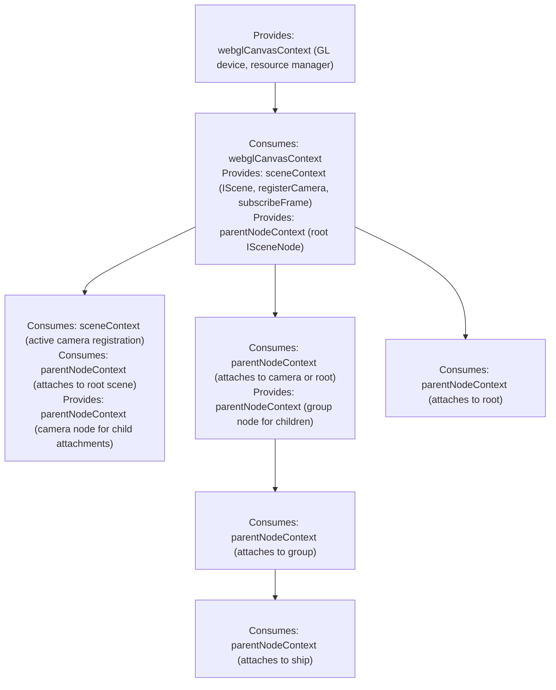

# Lit Scene & Web Component Architecture Design

## 1. Overview & Architectural Goals

### Purpose
This document specifies the architectural design for declarative Web Component scene bindings powered by Lit. The bindings provide a declarative authoring layer for the 3D scene graph, camera rigs, and render passes, bridging the browser's DOM tree directly to the programmatic core engine ([`src/scene/core/scene.ts`](core/scene.ts)) while exploiting the persistent, stateful lifecycle of Custom Elements.

### Design Goals
- **Persistent Object Identity:** Unlike React components which are re-invoked on every state change, a Lit element instance (`LitElement`) persists in memory across its entire DOM lifecycle (`connectedCallback` to `disconnectedCallback`). Programmatic engine objects ([`Scene`](core/scene.ts), [`SceneNode`](core/scene_node.ts), [`PerspectiveCamera`](camera/perspective_camera.ts)) live directly on the element instance without synthetic refs or hook bridges.
- **Zero Render-Loop Overhead:** Lit property updates mutate transform matrices, dirty flags, and camera frustum parameters directly on the underlying programmatic instances. Lit's reactive updates never drive the WebGL render loop or trigger GPU resource allocations.
- **Multi-Tier Lit Context Architecture:** Hierarchical scene binding uses the standard W3C Context protocol via `@lit/context` (`ContextProvider` / `ContextConsumer`). Context requests pierce Shadow DOM boundaries and `<slot>` projections without fragile CSS selector traversals.
- **Direct GPU Asset Property Forwarding:** Meshes, geometries, textures, and materials are passed directly as object properties on `<rj-model-instance>` rather than as declarative child DOM elements. This enforces GPU memory reuse (sharing 1 vertex buffer across 50 instances) and eliminates DOM bloat.
- **Light DOM Rendering:** Structural scene elements override `createRenderRoot()` to render in the Light DOM (`return this`), removing Shadow DOM encapsulation barriers and enabling transparent tree inspection and standard CSS/DOM querying.
- **First-Class React 19 Interoperability:** Because React 19 natively supports Custom Elements, these components can be embedded directly within React JSX trees, passing complex objects, numbers, and tuples directly as element properties and listening to custom bubbling events.
- **Strict Type Separation:** All element properties, custom event payloads, and DOM interface augmentations reside in dedicated `*_types.ts` files away from implementation classes.

---

## 2. Component & DOM Hierarchy



### Element Descriptions
- **`<rj-scene>`:** (Class `SceneElement`) Hosts the programmatic `Scene` instance, manages the simulation `requestAnimationFrame` loop, coordinates active camera selection, and bridges to render passes. Provides `sceneContext` and `parentNodeContext`.
- **`<rj-scene-group>` / `<rj-scene-node>`:** (Classes `SceneGroupElement` / `SceneNodeElement`) Instantiates a programmatic `SceneNode`, consumes `parentNodeContext` to attach to its parent, and re-provides `parentNodeContext` initialized to its own node for nested children.
- **`<rj-perspective-camera>`:** (Class `PerspectiveCameraElement`) Instantiates a programmatic `PerspectiveCamera`, synchronizes projection attributes (`fov`, `near`, `far`, `aspect`), registers itself with `sceneContext`, and provides `parentNodeContext` (so accessories or heads-up nodes attach to the camera).
- **`<rj-model-instance>`:** (Class `ModelInstanceElement`) Instantiates a programmatic `ModelInstance`, consumes `parentNodeContext`, and binds GPU `geometry` and `material` references passed directly via properties.

---

## 3. Lit Context Architecture & Self-Wiring Protocol

### Context Definitions (`scene_element_types.ts`)
Three distinct context tokens governed by unique `Symbol()` keys are exported directly from `scene_element_types.ts`:
- **`webglCanvasContext`:** `createContext<IWebGLCanvasContext>(Symbol("rj-webgl-canvas-context"))`. Provides the WebGL2 rendering device, canvas dimensions, resolution, and resource manager. Provided by `<webgl-canvas>`.
- **`sceneContext`:** `createContext<ISceneContext>(Symbol("rj-scene-context"))`. Provides the root `IScene` engine, active camera registrar, and demand-driven frame subscription loop. Provided by `<rj-scene>`.
- **`parentNodeContext`:** `createContext<ISceneNode>(Symbol("rj-parent-node-context"))`. Provides the immediate parent `ISceneNode`. Provided by `<rj-scene>` and shadowed/re-provided by each structural node (`<rj-scene-group>`, `<rj-perspective-camera>`).

By defining these context tokens in `scene_element_types.ts`, both providers and consumers can import them without importing implementation classes or introducing circular dependencies.

### Insertion & Attachment Procedure (`connectedCallback`)
When an element is inserted into the DOM tree:
- **Step 1 (Instantiation):** Instantiate the underlying programmatic engine instance if not already initialized.
- **Step 2 (Context Attachment):** `ContextConsumer` dispatches a composed `context-request` event.
  - Receives `parentNodeContext` and invokes `parentNode.addChild(this.node)`.
  - For cameras: receives `sceneContext` and invokes `scene.registerCamera(this.camera, this.makeDefault)`.
- **Step 3 (Context Provision):** Elements that can act as parents (`SceneElement`, `SceneGroupElement`, `PerspectiveCameraElement`) initialize a `ContextProvider` for `parentNodeContext` set to their programmatic node.
- **Step 4 (Event Notification):** Dispatch an optional bubbling `scene-node-attached` custom event (`bubbles: true`, `composed: true`) for diagnostic or telemetry observers.

### Removal & Cleanup Procedure (`disconnectedCallback`)
When an element is removed from the DOM:
- **Step 1 (Tree Unbinding):** Remove the programmatic node from its programmatic parent (`parentNode.removeChild(this.node)`).
- **Step 2 (Camera Deregistration):** If the element is a camera, invoke the unregister callback returned during registration.
- **Step 3 (Event Notification):** Dispatch a bubbling `scene-node-detached` custom event.
- **Step 4 (State Preservation):** Retain programmatic node configuration in memory so that moving the element in the DOM (detaching and re-attaching) seamlessly restores node state without recreating GPU resources.

### Property Synchronization & Dirty Flagging (`updated`)
- When reactive properties mutate, Lit invokes `updated(changedProperties: PropertyValues<this>)`.
- Check changed property keys (`changedProperties.has("prop")`) and update only the dirty fields on the programmatic instance:
  - Updates to `position`, `rotation`, or `scale` mutate the programmatic transform and mark the node's transform dirty.
  - Updates to camera `fov`, `aspect`, `near`, or `far` trigger projection matrix recalculation.
  - Updates to `geometry` or `material` on model instances swap asset references without creating new DOM nodes.
- No React re-render cycles or vDOM diffing occurs; changes propagate directly into the WebGL math structures.

---

## 4. API & Types Specification

### Type Definitions (`scene_element_types.ts`)
```ts
import { createContext } from "@lit/context";
import type { IScene, SceneFrameCallback } from "../core/scene_types";
import type { ISceneNode } from "../core/scene_node_types";
import type { ICamera } from "../camera/camera_types";

export interface IWebGLCanvasContext {
    readonly gl: WebGL2RenderingContext;
    readonly width: number;
    readonly height: number;
    readonly dpr: number;
}

export interface ISceneContext {
    readonly scene: IScene;
    readonly activeCamera: ICamera | null;
    registerCamera(camera: ICamera, makeDefault?: boolean): () => void;
    setActiveCamera(camera: ICamera | null): void;
    subscribeFrame(callback: SceneFrameCallback, priority?: number): () => void;
}

export const webglCanvasContext = createContext<IWebGLCanvasContext>(
    Symbol("rj-webgl-canvas-context")
);

export const sceneContext = createContext<ISceneContext>(
    Symbol("rj-scene-context")
);

export const parentNodeContext = createContext<ISceneNode>(
    Symbol("rj-parent-node-context")
);

export type Vector3Tuple = readonly [number, number, number];

export interface SceneElementProps {
    priority?: number;
    clearDepth?: boolean;
}

export interface SceneNodeElementProps {
    name?: string;
    position?: Vector3Tuple;
    rotation?: Vector3Tuple;
    scale?: Vector3Tuple;
    visible?: boolean;
}

export interface PerspectiveCameraElementProps extends SceneNodeElementProps {
    fov?: number;
    near?: number;
    far?: number;
    aspect?: number;
    makeDefault?: boolean;
}

/**
 * Strongly-Typed DOM Event Classes (scene_element_events.ts)
 */
export class SceneCameraChangedEvent extends Event {
    public static readonly TYPE = "scene-camera-changed";
    public readonly camera: ICamera | null;

    public constructor(camera: ICamera | null) {
        super(SceneCameraChangedEvent.TYPE, { bubbles: true, composed: true });
        this.camera = camera;
    }
}

export class SceneNodeAttachedEvent extends Event {
    public static readonly TYPE = "scene-node-attached";
    public readonly node: ISceneNode;
    public readonly element: HTMLElement;

    public constructor(node: ISceneNode, element: HTMLElement) {
        super(SceneNodeAttachedEvent.TYPE, { bubbles: true, composed: true });
        this.node = node;
        this.element = element;
    }
}

export class SceneNodeDetachedEvent extends Event {
    public static readonly TYPE = "scene-node-detached";
    public readonly node: ISceneNode;
    public readonly element: HTMLElement;

    public constructor(node: ISceneNode, element: HTMLElement) {
        super(SceneNodeDetachedEvent.TYPE, { bubbles: true, composed: true });
        this.node = node;
        this.element = element;
    }
}

declare global {
    interface HTMLElementTagNameMap {
        "rj-scene": SceneElement;
        "rj-scene-node": SceneNodeElement;
        "rj-scene-group": SceneGroupElement;
        "rj-perspective-camera": PerspectiveCameraElement;
    }

    interface HTMLElementEventMap {
        [SceneCameraChangedEvent.TYPE]: SceneCameraChangedEvent;
        [SceneNodeAttachedEvent.TYPE]: SceneNodeAttachedEvent;
        [SceneNodeDetachedEvent.TYPE]: SceneNodeDetachedEvent;
    }
}
```

### Public Element Interfaces
- **`SceneElement` (`<rj-scene>`):**
  - Properties: `priority` (number), `clearDepth` (boolean).
  - Public Readonly: `scene: IScene`, `activeCamera: ICamera | null`.
  - Public Methods:
    - `registerCamera(camera: ICamera, makeDefault?: boolean): () => void`
    - `setActiveCamera(camera: ICamera | null): void`
    - `subscribeFrame(callback: SceneFrameCallback, priority?: number): () => void`
- **`SceneGroupElement` (`<rj-scene-group>`):**
  - Properties: `name` (string), `position` (Vector3Tuple), `rotation` (Vector3Tuple), `scale` (Vector3Tuple), `visible` (boolean).
  - Public Readonly: `node: ISceneNode`.
- **`PerspectiveCameraElement` (`<rj-perspective-camera>`):**
  - Properties: Inherits transform properties plus `fov` (number), `near` (number), `far` (number), `aspect` (number), `makeDefault` (boolean).
  - Public Readonly: `camera: PerspectiveCamera`.

---

## 5. Pure Imports & Explicit Setup Functions

All element classes are exported directly without module-level auto-registration. Element registration is managed via explicit, flag-guarded setup functions:

- **Per-Element Setup:** Each element file exports an idempotent registration function (e.g., `setupSceneElement()`, `setupPerspectiveCameraElement()`).
- **Aggregated Setup (`setup_scene_elements.ts`):** Exports a single `setupSceneElements()` function that invokes all individual element setup functions in sequence.
- **Idempotency Guarantee:**
  ```ts
  let isRegistered = false;

  export function setupSceneElement(): void {
      if (isRegistered || typeof customElements === "undefined" || customElements.get("rj-scene")) {
          return;
      }
      customElements.define("rj-scene", SceneElement);
      isRegistered = true;
  }
  ```

### SPA Production Bootstrap (`src/index.tsx`)

In production, all elements are registered once at the application entry point before mounting React:

```tsx
// src/index.tsx
import { setupSceneElements } from "./scene/elements/setup_scene_elements";

// Bootstrap all custom elements for the application lifetime (idempotent)
setupSceneElements();

const root = document.getElementById("app")!;
createRoot(root).render(<RouterProvider router={router} />);
```

### Unit Test Setup & Happy DOM Isolation

- **Pure TypeScript Test Files:** Test files use `.test.ts` naming (e.g. `perspective_camera_element.test.ts`).
- **Happy DOM Routing:** Configured in `vitest.config.mts` via `include: ["src/**/*element*.{test,spec}.ts"]` under the `dom` project.
- **Isolated Per-Suite Registration:** Unit tests never rely on global element pre-registration. Each test suite explicitly registers only the element under test in `beforeAll()`:

```ts
import { describe, it, expect, beforeAll, beforeEach, afterEach } from "vitest";
import { setupPerspectiveCameraElement } from "./perspective_camera_element";
import { PerspectiveCameraElement } from "./perspective_camera_element";

describe("PerspectiveCameraElement (<rj-perspective-camera>)", () => {
    beforeAll(() => {
        setupPerspectiveCameraElement();
    });

    let el: PerspectiveCameraElement;

    beforeEach(() => {
        el = document.createElement("rj-perspective-camera");
        document.body.appendChild(el);
    });

    afterEach(() => {
        el.remove();
    });

    it("initializes with default camera properties", () => {
        expect(el.camera).toBeDefined();
    });
});
```

### React 19 Interoperability & Usage Example

Because React 19 supports Custom Elements natively, the custom elements render seamlessly within any React component tree without special React wrapper components:

```tsx
export function GalaxySceneView() {
    return (
        <webgl-canvas>
            <rj-scene priority={10} clearDepth>
                <rj-perspective-camera
                    fov={45}
                    aspect={16 / 9}
                    near={0.1}
                    far={1000}
                    position={[0, 5, 20]}
                    makeDefault
                />
                <rj-scene-group position={[0, 0, 0]} rotation={[0, 0.5, 0]}>
                    <rj-model-instance />
                </rj-scene-group>
            </rj-scene>
        </webgl-canvas>
    );
}
```

---

## 6. Selected Binding Location: `src/scene/elements/`

- `src/scene/elements/webgl_canvas_element_constants.ts`: Tag name (`rj-webgl-canvas`), event names, default DPR cap, and attribute constants.
- `src/scene/elements/webgl_canvas_element_types.ts`: Props interface, subscriber types, and `HTMLElementTagNameMap` augmentation.
- `src/scene/elements/webgl_canvas_element_events.ts`: Strongly-typed native `Event` subclasses (`WebGLContextCreatedEvent`, `WebGLContextLostEvent`, `WebGLContextRestoredEvent`, `WebGLResizeEvent`).
- `src/scene/elements/webgl_canvas_element.ts`: `<rj-webgl-canvas>` implementation (`WebGLCanvasElement`) and `setupWebGLCanvasElement()`.
- `src/scene/elements/scene_element_constants.ts`: Tag names (`rj-scene`, `rj-perspective-camera`, etc.), event names, default priorities, and camera defaults (zero magic numbers).
- `src/scene/elements/scene_element_types.ts`: TypeScript contracts, property interfaces, Symbol-keyed Lit Context tokens (`webglCanvasContext`, `sceneContext`, `parentNodeContext`), and native element map augmentations.
- `src/scene/elements/scene_element_events.ts`: Strongly-typed native `Event` subclasses (`SceneCameraChangedEvent`, `SceneNodeAttachedEvent`, `SceneNodeDetachedEvent`) and `HTMLElementEventMap` augmentation.
- `src/scene/elements/scene_element.ts`: `<rj-scene>` implementation (`SceneElement`) and `setupSceneElement()`.
- `src/scene/elements/scene_node_element.ts`: `<rj-scene-node>` and `<rj-scene-group>` implementations and `setupSceneNodeElements()`.
- `src/scene/elements/perspective_camera_element.ts`: `<rj-perspective-camera>` implementation (`PerspectiveCameraElement`) and `setupPerspectiveCameraElement()`.
- `src/scene/elements/model_instance_element.ts`: `<rj-model-instance>` implementation (`ModelInstanceElement`) and `setupModelInstanceElement()`.
- `src/scene/elements/setup_scene_elements.ts`: Unified, flag-guarded `setupSceneElements()` registration entry point.
