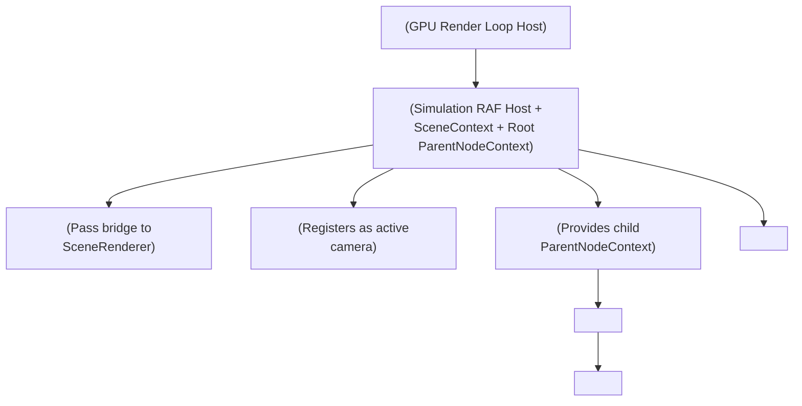
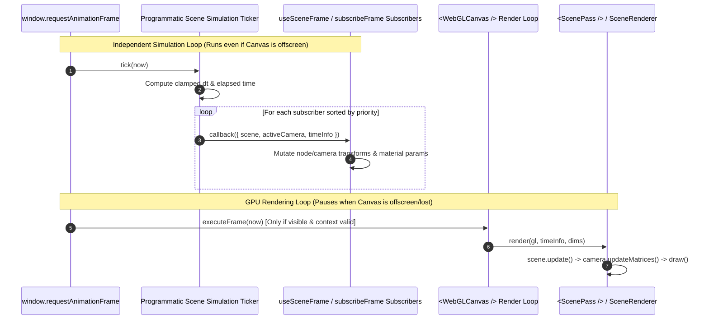

# Declarative React Scene Architecture Design

## 1. Overview & Architectural Goals

### Purpose
This document specifies the architectural design for declarative React bindings integrated with the programmatic 3D scene engine. While complex physics simulations and raw procedural compute benefit from direct imperative scene graph manipulation, scenic presentations, interactive UI showcases, landing experiences, and camera tour rigs benefit from declarative JSX composition.

### Key Architectural Principles
- **Thin Declarative Wrapper over Programmatic Core:** Declarative JSX components do not implement rendering or GPU operations. They serve as lifecycle controllers that instantiate, configure, and synchronize programmatic [`ISceneNode`](../core/scene_node_types.ts), [`IScene`](../core/scene_types.ts), [`ICamera`](../camera/camera_types.ts), and [`IModelInstance`](../models/model_instance_types.ts) instances.
- **Zero Render-Loop Overhead:** React re-renders must never drive the WebGL render loop or trigger GPU buffer reallocations. Transform updates (such as translation or rotation) mutate the underlying programmatic transform directly inside lifecycle effects without triggering React reconciliation across children.
- **Separation of Simulation Behavior from WebGL Rendering:** `<Scene />` hosts its own independent, demand-driven `requestAnimationFrame` simulation loop via `SceneContext` and `useSceneFrame`. Scene behavior (camera rigs, parallax damping, tour trajectories, and node kinematics) advances continuously without freezing when [`<WebGLCanvas />`](../../components/webgl_canvas/webgl_canvas.tsx) pauses GPU draw calls (such as when scrolled offscreen or during WebGL context loss).
- **Two-Tier Context Architecture:**
  - **Root Scene Context (`SceneContext`):** Delivers the active root [`IScene`](../core/scene_types.ts) instance, camera registration mechanics, simulation frame subscription (`subscribeFrame`), and orchestration with the enclosing [`ScenePass`](../renderer/scene_pass.tsx).
  - **Polymorphic Parent Context (`ParentNodeContext`):** Provides the immediate parent [`ISceneNode`](../core/scene_node_types.ts). Because [`IScene`](../core/scene_types.ts), [`SceneNode`](../core/scene_node.ts), [`Camera`](../camera/camera.ts), and [`ModelInstance`](../models/model_instance.ts) all implement [`ISceneNode`](../core/scene_node_types.ts), any component in the tree can act as a parent simply by re-providing its node instance.
- **First-Class React 19 Conventions:** Uses function components only, direct `ref` props (no `forwardRef`), and returns cleanup closures from lifecycle effects.
- **Strict Separation of Types:** All prop contracts, context signatures, and tuple types reside in dedicated type definition files (`scene_react_types.ts`) away from component implementations.

---

## 2. High-Level Component & Context Hierarchy



### Context Distribution Flow
- **`<Scene>`:** Initializes programmatic `Scene`, hosts the independent simulation `requestAnimationFrame` ticker, mounts `<ScenePass>`, and provides `SceneContext` (scene + camera registrar + frame subscriber) and `ParentNodeContext` (root `scene`).
- **`<Group>`:** Instantiates `SceneNode`, mounts to enclosing `ParentNodeContext`, and re-provides itself as `ParentNodeContext` for all nested children.
- **`<PerspectiveCamera>`:** Instantiates `PerspectiveCamera`, attaches to enclosing `ParentNodeContext`, and registers with `SceneContext.registerCamera()`.
- **`<ModelInstance>`:** Instantiates `ModelInstance`, attaches to enclosing `ParentNodeContext`, and re-provides itself as `ParentNodeContext` (allowing nested child nodes or accessories).

---

## 3. Directory Layout & Module Structure

All declarative React bindings reside in `src/scene/react/`:

- **Type Contracts:**
  - [`src/scene/react/scene_react_types.ts`](scene_react_types.ts): TypeScript interfaces for component props, frame callback state, tuple aliases, and React context contracts.
- **Context & Hooks:**
  - [`src/scene/react/scene_context.ts`](scene_context.ts): `SceneContext`, `ParentNodeContext`, and consumer hooks (`useScene`, `useParentNode`).
  - [`src/scene/react/use_scene_node.ts`](use_scene_node.ts): Core lifecycle hook managing node attachment, cleanup, and transform reconciliation.
  - [`src/scene/react/use_scene_frame.ts`](use_scene_frame.ts): Hook subscribing behavior and simulation callbacks to the `<Scene />` simulation loop.
- **Declarative Components:**
  - [`src/scene/react/scene_component.tsx`](scene_component.tsx): Declarative `<Scene />` root component hosting the simulation loop and wrapping [`<ScenePass />`](../renderer/scene_pass.tsx).
  - [`src/scene/react/group_component.tsx`](group_component.tsx): Declarative `<Group />` mapping to programmatic `SceneNode`.
  - [`src/scene/react/camera_component.tsx`](camera_component.tsx): Declarative `<PerspectiveCamera />` component mapping to `PerspectiveCamera`.
  - [`src/scene/react/model_instance_component.tsx`](model_instance_component.tsx): Declarative `<ModelInstance />` component mapping to `ModelInstance`.

---

## 4. API & Type Specifications

### Tuple & Common Types
```typescript
import type React from "react";
import type { IScene } from "../core/scene_types";
import type { ISceneNode } from "../core/scene_node_types";
import type { ICamera } from "../camera/camera_types";
import type { IMeshGeometry } from "../models/mesh_geometry_types";
import type { IMaterial } from "../materials/material_types";
import type { TimeInfo } from "../../webgl/canvas/canvas_types";

export type Vector3Tuple = [x: number, y: number, z: number];
export type EulerTuple = [pitch: number, yaw: number, roll: number];

export interface SceneNodeProps {
    /** Label for debugging */
    name?: string;
    /** Position relative to parent [x, y, z] */
    position?: Vector3Tuple;
    /** Euler rotation angles in radians [pitch, yaw, roll] */
    rotation?: EulerTuple;
    /** Uniform scalar or 3-component scale [x, y, z] */
    scale?: Vector3Tuple | number;
    /** Local visibility toggle */
    visible?: boolean;
    /** Nested children scene nodes */
    children?: React.ReactNode;
    /** Direct React 19 node ref */
    ref?: React.Ref<ISceneNode>;
}
```

### Simulation Frame Callback & Context Signatures
```typescript
/**
 * Execution state delivered to every registered useSceneFrame callback on each simulation tick.
 * Decoupled from WebGL2RenderingContext so behavior continues even when GPU rendering is paused.
 */
export interface SceneFrameState {
    /** Underlying programmatic scene instance */
    readonly scene: IScene;
    /** Current active camera appointed to the scene */
    readonly activeCamera: ICamera | null;
    /** Simulation timing metrics (elapsed seconds, clamped delta seconds, tick count) */
    readonly timeInfo: TimeInfo;
}

export type SceneFrameCallback = (state: SceneFrameState) => void;

export interface SceneFrameSubscriber {
    readonly id: string;
    readonly priority: number;
    readonly callback: SceneFrameCallback;
}

export interface ISceneContextValue {
    /** Underlying programmatic scene instance */
    readonly scene: IScene;
    /** Current active camera rendering the scene */
    readonly activeCamera: ICamera | null;
    /** Manually appoint the active camera */
    setActiveCamera: (camera: ICamera | null) => void;
    /** Registers a camera with the scene. Returns unregister cleanup closure. */
    registerCamera: (camera: ICamera, makeDefault?: boolean) => () => void;
    /** Subscribes a simulation/behavior callback to the scene's independent RAF loop. */
    subscribeFrame: (callback: SceneFrameCallback, priority?: number) => () => void;
}

export interface IParentNodeContextValue {
    /** Immediate parent scene node in the graph hierarchy */
    readonly parent: ISceneNode;
}
```

### Component Props Contracts
```typescript
export interface SceneProps {
    /** Pass execution priority in WebGLCanvas (default: 10) */
    priority?: number;
    /** Whether to clear the depth buffer prior to rendering (default: true) */
    clearDepth?: boolean;
    /** Scene graph children (cameras, groups, model instances, behavior controllers) */
    children?: React.ReactNode;
    /** Direct ref to underlying programmatic Scene */
    ref?: React.Ref<IScene>;
}

export interface GroupProps extends SceneNodeProps {
    /** Direct ref to underlying programmatic SceneNode */
    ref?: React.Ref<ISceneNode>;
}

export interface PerspectiveCameraProps extends SceneNodeProps {
    /** Field of view in degrees (default: 60) */
    fov?: number;
    /** Near clipping plane distance (default: 0.1) */
    near?: number;
    /** Far clipping plane distance (default: 1000.0) */
    far?: number;
    /** Explicit aspect ratio; if omitted, automatically tracks viewport */
    aspect?: number;
    /** Automatically sets this camera as the scene's active rendering camera */
    makeDefault?: boolean;
    /** Direct ref to underlying programmatic Camera */
    ref?: React.Ref<ICamera>;
}

export interface ModelInstanceProps extends SceneNodeProps {
    /** Target geometry defining vertex layout and buffers */
    geometry: IMeshGeometry;
    /** Target material defining shader, uniforms, and pipeline state */
    material: IMaterial;
    /** Explicit render order queue (lower values render first) */
    renderOrder?: number;
    /** Direct ref to underlying programmatic ModelInstance */
    ref?: React.Ref<IModelInstance>;
}
```

---

## 5. Lifecycle & Synchronization Procedures

### Node Attachment & Detachment Procedure
1. **Creation:** The component instantiates its programmatic instance once per lifecycle or accepts an existing instance via props/factory.
2. **Context Resolution:** The component queries `useParentNode()` to resolve the immediate enclosing parent node.
3. **Graph Mount:** In a layout/mount effect, the child invokes `parent.addChild(node)`.
4. **Cleanup:** On unmount or if the parent context changes, the child invokes `parent.removeChild(node)` and disposes resources via `node.destroy()`.

### Transform Reconciliation Algorithm
To prevent re-rendering the entire React subtree when spatial properties change:
1. The `useSceneNode` hook observes `position`, `rotation`, `scale`, and `visible` props.
2. In an effect, each property is compared with the node's cached state:
   - If `position` changed: invokes `node.transform.setPosition(x, y, z)`.
   - If `rotation` changed: invokes `node.transform.setRotationEuler(pitch, yaw, roll)`.
   - If `scale` changed: invokes `node.transform.setScale(scale)` or `node.transform.setScale(x, y, z)`.
   - If `visible` changed: updates `node.visible = visible`.
3. The transform changes mark the node's world matrix dirty, seamlessly propagating down the tree during the engine's render cycle with zero React reconciliation overhead.

###Camera Registration Procedure
1. When `<PerspectiveCamera>` mounts, it checks the `makeDefault` prop.
2. It calls `registerCamera(camera, makeDefault)` from `SceneContext`, which delegates to `scene.registerCamera(camera, makeDefault)` and syncs React's `activeCamera` state with `scene.activeCamera`.
3. If `makeDefault` is true (or if `scene.activeCamera` is currently `null`), `scene.registerCamera` appoints this camera as `scene.activeCamera`.
4. When `activeCamera` changes, `<Scene>` passes the active camera to `<ScenePass camera={activeCamera} />`.
5. On unmount, the unregister closure returned by `scene.registerCamera` removes the camera from `Scene`'s internal camera list and falls back to the last remaining registered camera (or `null`), syncing React state accordingly.

### Decoupled Scene Simulation Loop (`Scene.subscribeFrame` & `useSceneFrame`)



1. **Programmatic Scene Ownership & Demand-Driven Activation:**
   - The programmatic [`Scene`](../core/scene.ts) class maintains the internal `Map<string, SceneFrameSubscriber>` and cached priority-sorted subscriber array via `scene.subscribeFrame(callback, priority)`.
   - `<Scene />` exposes `subscribeFrame` on `SceneContext` by delegating directly to `scene.subscribeFrame`, and `useSceneFrame` subscribes to it.
   - When the subscriber count is `0`, no `requestAnimationFrame` loop is scheduled (zero idle overhead for static scenes).
   - As soon as the first subscriber registers (`subscribers.size === 1`), `Scene` starts its `requestAnimationFrame` simulation loop.
2. **Delta-Time Clamping & Monotonic Clock:**
   - On each tick, raw delta time `rawDt = (now - lastTime) / 1000` is clamped to `[0.0001, 0.1]` seconds to prevent physics or damping explosions after tab switches.
   - `elapsedTime` accumulates clamped `dt` and `frameCount` increments monotonically.
3. **Priority-Ordered Execution:**
   - Subscribers are sorted in ascending `priority` order (`default: 0`) whenever the subscriber set changes.
   - Each subscriber receives `{ scene, activeCamera: scene.activeCamera, timeInfo }`.
4. **Decoupling from WebGL Visibility:**
   - Because `Scene` manages its own simulation `requestAnimationFrame` handle independently of `<WebGLCanvas />`, scrolling the canvas out of view pauses WebGL draw calls in `<WebGLCanvas />` while `Scene` behavior controllers continue updating cleanly.
5. **Deterministic Teardown:**
   - When the last subscriber unsubscribes (or when `scene.destroy()` is called on `<Scene />` unmount), `cancelAnimationFrame` is called immediately and all subscribers/cameras are cleared.

---

## 6. Declarative JSX Usage Examples

### Example 1: Basic Showcase Scene
```tsx
import { WebGLCanvas } from "../../components/webgl_canvas/webgl_canvas";
import { Scene } from "./scene_component";
import { PerspectiveCamera } from "./camera_component";
import { ModelInstance } from "./model_instance_component";

export function BasicShowcase({ shipGeo, shipMat, starsGeo, starsMat }) {
    return (
        <WebGLCanvas options={{ autoClear: true, clearColor: [0.02, 0.02, 0.05, 1] }}>
            <Scene>
                {/* Default active camera */}
                <PerspectiveCamera position={[0, 10, 30]} fov={60} makeDefault />

                {/* Central spacecraft model */}
                <ModelInstance
                    name="hero-ship"
                    position={[0, 0, 0]}
                    rotation={[0, Math.PI / 6, 0]}
                    geometry={shipGeo}
                    material={shipMat}
                    renderOrder={0}
                />

                {/* Background stars */}
                <ModelInstance
                    name="backdrop-stars"
                    geometry={starsGeo}
                    material={starsMat}
                    renderOrder={100}
                />
            </Scene>
        </WebGLCanvas>
    );
}
```

### Example 2: Hierarchical Grouping & Nested Parenting
```tsx
import { Scene } from "./scene_component";
import { Group } from "./group_component";
import { ModelInstance } from "./model_instance_component";

export function PlanetarySystem({ sunGeo, sunMat, planetGeo, planetMat, moonGeo, moonMat }) {
    return (
        <Scene>
            <ModelInstance name="sun" geometry={sunGeo} material={sunMat} />

            {/* Orbiting planetary system group */}
            <Group name="planet-orbit-group" position={[50, 0, 0]}>
                <ModelInstance name="planet" geometry={planetGeo} material={planetMat} />

                {/* Moon parented directly to planet */}
                <ModelInstance
                    name="moon"
                    position={[10, 2, 0]}
                    scale={0.3}
                    geometry={moonGeo}
                    material={moonMat}
                />
            </Group>
        </Scene>
    );
}
```

### Example 3: Dynamic State Synchronization
```tsx
import { useState } from "react";
import { ModelInstance } from "./model_instance_component";
import type { Vector3Tuple } from "./scene_react_types";

export function InteractiveProbe({ probeGeo, probeMat }) {
    const [elevation, setElevation] = useState(5);
    const position: Vector3Tuple = [0, elevation, 0];

    return (
        <ModelInstance
            position={position}
            geometry={probeGeo}
            material={probeMat}
        />
    );
}
```

### Example 4: Continuous Simulation & Camera Rig Behavior via `useSceneFrame`
```tsx
import { useRef } from "react";
import { ModelInstance } from "./model_instance_component";
import { useSceneFrame } from "./use_scene_frame";
import type { IModelInstance } from "../models/model_instance_types";

export function SpinningAsteroid({ geo, mat }) {
    const asteroidRef = useRef<IModelInstance>(null);

    useSceneFrame(({ timeInfo }) => {
        if (asteroidRef.current) {
            asteroidRef.current.transform.setRotationEuler(
                timeInfo.time * 0.2,
                timeInfo.time * 0.5,
                0
            );
        }
    });

    return <ModelInstance ref={asteroidRef} geometry={geo} material={mat} />;
}
```

---

## 7. Phased Implementation Plan

Implementation will proceed following the phased subagent design protocol:

- **Phase 1: Types & Context Contracts**
  - Author [`scene_react_types.ts`](scene_react_types.ts) with full type separation (including `SceneFrameState`, `SceneFrameCallback`, `SceneFrameSubscriber`).
  - Implement [`scene_context.ts`](scene_context.ts) establishing `SceneContext`, `ParentNodeContext`, `useScene`, and `useParentNode`.
- **Phase 2: Core Lifecycle & Simulation Frame Hooks**
  - Author [`use_scene_node.ts`](use_scene_node.ts) implementing mount attachment, cleanup detachment, resource destruction, and prop-diffing transform updates.
  - Author [`use_scene_frame.ts`](use_scene_frame.ts) subscribing behavior callbacks to the scene simulation loop.
- **Phase 3: Declarative Component Implementations**
  - Implement [`scene_component.tsx`](scene_component.tsx) hosting the demand-driven simulation `requestAnimationFrame` loop and integrating with [`ScenePass`](../renderer/scene_pass.tsx).
  - Implement [`group_component.tsx`](group_component.tsx) for hierarchical groupings.
  - Implement [`camera_component.tsx`](camera_component.tsx) with camera registration and aspect synchronization.
  - Implement [`model_instance_component.tsx`](model_instance_component.tsx) with renderable geometry and material bindings.
- **Phase 4: Independent Unit Test Authoring**
  - Delegate comprehensive unit test suite authoring covering node mounting, hierarchy nesting, camera registration, simulation frame loop execution, unmount detachment, and prop transform reconciliation.
- **Phase 5: Quality Gate & Verification**
  - Verify full test suite passes (`npm test`).
  - Verify production build completes cleanly (`npm run build`).
