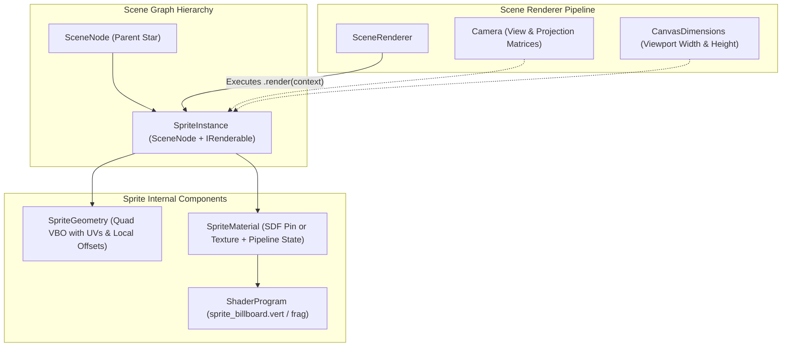

# Sprite & Billboard Waypoint System Design

## 1. Executive Summary & Design Goals

### Overview
This document specifies the architectural design for camera-facing 2D/3D billboard sprites in the rendering engine, formalized through **`SpriteInstance`**. While standard 3D meshes maintain fixed world-space orientations, billboard sprites continuously orient themselves toward the camera viewpoint. 

The primary catalyst for this subsystem is displaying **waypoint markers**—such as high-visibility "Red Pins" indicating origin, destination, and points of interest along a 3D galactic navigation route. Beyond navigation pins, this subsystem provides the foundation for target reticles, celestial lens flares, floating HUD tags, and stellar markers.

### Key Architectural Principles
- **Configurable Normalized Anchor:** Quad vertices are defined relative to a continuous normalized 2D anchor point $(\alpha_x, \alpha_y) \in [0, 1]^2$. For a map pin, an anchor of $(0.5, 0.0)$ anchors the bottom tip precisely at the 3D target coordinates, while allowing other entities to anchor at center $(0.5, 0.5)$ or arbitrary pivots.
- **Versatile Sizing Modes:** Supports three distinct size paradigms via `SpriteSizeMode`: fixed screen-space pixels (default for navigation pins), true world units, and distance-clamped screen pixels.
- **Dual Visual Engines:** Supports both procedural 2D Signed Distance Field (SDF) pins (zero external textures, mathematically crisp at any resolution) and traditional texture maps (PNG/WebP icons, sprite sheets).
- **Flexible Occlusion & Depth:** Provides clear execution pathways for standard depth testing, always-on-top rendering, and two-pass X-Ray ghost outlines when occluded by celestial bodies.
- **Strong Typing Project-Wide:** Uses strongly-typed enums for modes, [`Vector2Like`](../../maths/vector_types.ts) for coordinates and dimensions, and [`NormalizedRgbaTuple`](../../helpers/colors_types.ts) for colors.
- **First-Class Scene Citizen:** Extends [`SceneNode`](../core/scene_node.ts) and implements [`IRenderable`](../core/renderable_types.ts), enabling transformation hierarchies, parenting to moving star nodes, and seamless rendering via [`SceneRenderer`](../renderer/scene_renderer.ts).

---

## 2. System Architecture & Component Flow



---

## 3. Normalized Anchor Point Mechanics

### Definition & Space Coordinates
A sprite's anchor defines the pivot point on the sprite's $2\text{D}$ plane that coincides exactly with the 3D position of the `SpriteInstance`'s world transform:

- $(\alpha_x, \alpha_y) = (0.5, 0.0)$: Bottom-center tip (Standard map pin touching a star).
- $(\alpha_x, \alpha_y) = (0.5, 0.5)$: Center-center (Star flare, circular reticle, particle).
- $(\alpha_x, \alpha_y) = (0.0, 1.0)$: Top-left (Dropdown tooltip, contextual callout box).

```
   (0, 1) +-------------------------+ (1, 1)
          |                         |
          |     (0.5, 0.5) Center   |
          |            +            |
          |                         |
          |                         |
          +------------+------------+ (1, 0)
   (0, 0)        (0.5, 0.0) Tip Anchor
                       * (3D Scene Position)
```

### Local Vertex Offsets
Given sprite dimensions $(w, h)$ and anchor coordinates $(\alpha_x, \alpha_y)$, the four bounding corner positions in the sprite's local 2D plane are computed as:

- Bottom-Left ($v_0$): $x_0 = -\alpha_x \cdot w, \quad y_0 = -\alpha_y \cdot h$
- Bottom-Right ($v_1$): $x_1 = (1 - \alpha_x) \cdot w, \quad y_1 = -\alpha_y \cdot h$
- Top-Right ($v_2$): $x_2 = (1 - \alpha_x) \cdot w, \quad y_2 = (1 - \alpha_y) \cdot h$
- Top-Left ($v_3$): $x_3 = -\alpha_x \cdot w, \quad y_3 = (1 - \alpha_y) \cdot h$

Because UV coordinates remain fixed $[(0, 0), (1, 0), (1, 1), (0, 1)]$, the anchor transformation can either be baked into a CPU-side unit quad buffer or evaluated in the vertex shader by passing the anchor vector as a uniform.

---

## 4. Billboard Modes & Orientation Mathematics

The orientation behavior is controlled by the strongly-typed enum `BillboardMode`:

```typescript
export enum BillboardMode {
    /** Quad rotates freely across all axes to directly face the camera lens plane */
    Spherical = 0,
    /** Quad rotates exclusively around the world Y-axis, remaining upright */
    Cylindrical = 1,
}
```

### Spherical Billboarding (View-Plane Aligned)
Spherical billboarding ensures the sprite faces the camera squarely, preventing distortion when the camera tilts, pitches, or rolls around galactic waypoints:

- **Algorithm via Model-View Matrix Deconstruction:**
  Given camera view matrix $\mathbf{V}$ and node world transform $\mathbf{M}_{\text{world}}$, the composite model-view matrix is $\mathbf{MV} = \mathbf{V} \cdot \mathbf{M}_{\text{world}}$.
  The upper $3\times 3$ portion of $\mathbf{MV}$ encodes rotation and scale. To cancel all rotation while preserving node scaling:
  $$\mathbf{MV}_{\text{billboard}}[0, 0] = \|\mathbf{M}_{\text{col0}}\|, \quad \mathbf{MV}_{\text{billboard}}[1, 1] = \|\mathbf{M}_{\text{col1}}\|, \quad \mathbf{MV}_{\text{billboard}}[2, 2] = \|\mathbf{M}_{\text{col2}}\|$$
  All other non-diagonal entries in the upper $3\times 3$ are set to $0$.

- **Algorithm via Camera Basis Vectors:**
  Alternatively, in the vertex shader, extract camera right vector $\mathbf{R}_{\text{cam}}$ and up vector $\mathbf{U}_{\text{cam}}$ from the view matrix:
  $$\mathbf{p}_{\text{world}} = \mathbf{p}_{\text{anchor}} + (x_{\text{local}} \cdot \mathbf{R}_{\text{cam}}) + (y_{\text{local}} \cdot \mathbf{U}_{\text{cam}})$$

### Cylindrical Billboarding (Axial / World-Up Aligned)
When waypoint pins must stand upright relative to the galactic plane (the world Y-axis):
1. Extract the vector from camera to anchor: $\mathbf{F} = \text{normalize}(\mathbf{p}_{\text{anchor}} - \mathbf{p}_{\text{camera}})$.
2. Define world up: $\mathbf{U}_{\text{world}} = \begin{bmatrix} 0 \\ 1 \\ 0 \end{bmatrix}$.
3. Compute horizontal billboard right vector: $\mathbf{R} = \text{normalize}(\mathbf{U}_{\text{world}} \times \mathbf{F})$.
4. Recompute true facing normal: $\mathbf{N} = \mathbf{R} \times \mathbf{U}_{\text{world}}$.
5. Position: $\mathbf{p}_{\text{world}} = \mathbf{p}_{\text{anchor}} + (x_{\text{local}} \cdot \mathbf{R}) + (y_{\text{local}} \cdot \mathbf{U}_{\text{world}})$.

---

## 5. Sizing Modes & Scaling Algorithms

Sprite sizing is governed by `SpriteSizeMode`:

```typescript
export enum SpriteSizeMode {
    /** Fixed dimension in screen pixels regardless of camera distance (Default) */
    ScreenSpace = 0,
    /** Sized in 3D world units, scaling with perspective distance */
    WorldSpace = 1,
    /** Scales with perspective distance, but clamped between min and max pixel bounds */
    ClampedScreenSpace = 2,
}
```

### Mode 1: Fixed Screen-Space Pixels (`SpriteSizeMode.ScreenSpace`) — Default
Maintains constant, readable dimensions (e.g. $36\text{px} \times 48\text{px}$) across the entire galactic zoom range.

- **Vertex Shader Formulation:**
  1. Project the 3D anchor position to homogeneous clip space:
     $$\mathbf{c}_{\text{anchor}} = \mathbf{P}_{\text{proj}} \cdot \mathbf{V}_{\text{view}} \cdot \mathbf{M}_{\text{world}} \cdot \begin{bmatrix} 0 \\ 0 \\ 0 \\ 1 \end{bmatrix}$$
  2. Compute screen pixel offset vector using viewport resolution $(\text{res}_x, \text{res}_y)$:
     $$\Delta x_{\text{clip}} = \frac{2 \cdot x_{\text{local}}}{\text{res}_x} \cdot \mathbf{c}_{\text{anchor}}.w, \quad \Delta y_{\text{clip}} = \frac{2 \cdot y_{\text{local}}}{\text{res}_y} \cdot \mathbf{c}_{\text{anchor}}.w$$
  3. Output final clip position:
     $$\mathbf{c}_{\text{final}} = \begin{bmatrix} \mathbf{c}_{\text{anchor}}.x + \Delta x_{\text{clip}} \\ \mathbf{c}_{\text{anchor}}.y + \Delta y_{\text{clip}} \\ \mathbf{c}_{\text{anchor}}.z \\ \mathbf{c}_{\text{anchor}}.w \end{bmatrix}$$
  *Notice:* Multiplying by $\mathbf{c}_{\text{anchor}}.w$ cancels out the perspective division ($\div w$) that the GPU performs during rasterization, guaranteeing exact pixel dimensions!

### Mode 2: World-Space Units (`SpriteSizeMode.WorldSpace`)
The sprite behaves like physical scene geometry. Dimensions $(w, h)$ are measured in world units, expanding when close and shrinking to sub-pixel points when distant.
- Vertex position:
  $$\mathbf{v}_{\text{view}} = (\mathbf{V}_{\text{view}} \cdot \mathbf{p}_{\text{anchor}}).xyz + \begin{bmatrix} x_{\text{local}} \\ y_{\text{local}} \\ 0 \end{bmatrix}$$
  $$\mathbf{c}_{\text{final}} = \mathbf{P}_{\text{proj}} \cdot \begin{bmatrix} \mathbf{v}_{\text{view}} \\ 1 \end{bmatrix}$$

### Mode 3: Clamped Screen Space (`SpriteSizeMode.ClampedScreenSpace`)
Scales with distance, but clamps between a minimum pixel size (e.g. 16px) and maximum pixel size (e.g. 96px).
- Compute apparent pixel size at current distance $d = \|\mathbf{p}_{\text{anchor}} - \mathbf{p}_{\text{cam}}\|$.
- $\text{scale} = \text{clamp}\left(\frac{\text{baseSize} \cdot \text{focalLength}}{d}, \text{minPixels}, \text{maxPixels}\right) / \text{baseSize}$.
- Apply $\text{scale}$ to the screen-space extrusion calculation.

---

## 6. Occlusion & Depth Handling Strategies

Waypoint navigation markers must handle depth gracefully. Three operational modes are supported:

### Behavior A: Standard Depth Testing
- **Configuration:** `depthTest: true, depthWrite: false`.
- **Render Queue:** Transparent (`renderOrder >= 1000`).
- **Result:** Waypoint pins occlude naturally when behind planets, stars, or volumetric nebulas. When in front, they render cleanly over the background.

### Behavior B: Always-On-Top
- **Configuration:** `depthTest: false, depthWrite: false`.
- **Render Queue:** Overlay (`renderOrder >= 5000`).
- **Result:** Pins are unconditionally visible, rendering on top of all celestial bodies. Ideal for global map navigation when the user must locate destinations anywhere in the galaxy.

### Behavior C: Multi-Pass X-Ray Ghost Outline (Deferred Architecture)
In navigation systems, viewing a waypoint through celestial bodies via a ghost outline or silhouette requires a multi-pass technique (Pass 1 occluded with `gl.GREATER`, Pass 2 visible with `gl.LEQUAL`). Because the current `SceneRenderer` pipeline organizes draw calls around single-pass `render(context)` invocations, full multi-pass orchestration will be specified in a dedicated future multi-pass rendering architecture design document. For initial implementation, `SpriteInstance` will support **Behavior A (Standard Depth Testing)** and **Behavior B (Always-On-Top)**.

---

## 7. Visual Representation: SDF Procedural Pin vs. Texture Mode

### 1. Procedural SDF Pin Shader (Default)
Drawing the waypoint pin via 2D Signed Distance Fields in the fragment shader eliminates external image dependencies, delivers perfect resolution independence, and allows dynamic styling (colors, core indicators, glow) through uniforms.

```
       ,---.
      /     \    <-- Circle: ||p - c|| - r
     |   o   |   <-- Inner Dot: ||p - c|| - r_inner
      \     /
       \   /     <-- Tapered Wedge: Isosceles triangle SDF
        \ /
         V       <-- Tip Anchor at (0, 0)
```

- **SDF Mathematical Primitives:**
  In fragment coordinates normalized to $p \in [-0.5, 0.5] \times [0, 1.0]$:
  1. **Head Circle Center:** $c = (0.0, 0.65)$, radius $r = 0.32$.
     $$d_{\text{circle}} = \|p - c\| - r$$
  2. **Tapered Tip Wedge:** Signed distance to a 2D isosceles triangle pointing to $(0, 0)$ and merging smoothly with the head circle.
  3. **Pin Body SDF:**
     $$d_{\text{pin}} = \min(d_{\text{circle}}, d_{\text{wedge}})$$
  4. **Inner White Dot:**
     $$d_{\text{inner}} = \|p - c\| - 0.12$$
- **Fragment Shading & Antialiasing:**
  - Pin boundary anti-aliased via `smoothstep(0.0, -pixelDelta, d_pin)`.
  - Color blending:
    - Base Pin: `u_tintColor` (e.g. Red `[1.0, 0.15, 0.15, 1.0]`).
    - Inner Dot: `u_innerDotColor` (e.g. White `[1.0, 1.0, 1.0, 1.0]`).
    - Halo / Drop Shadow: Exponential falloff outside $d_{\text{pin}} > 0$.

### 2. Texture Mode (Custom Sprite / PNG)
When custom artwork (e.g. checkered flags, military insignia, or UI iconography) is desired:
- **Material Binding:**
  - Shader: `sprite_billboard.frag` with texture sampler `u_texture` bound to `TextureUnit.Color0`.
- **Sampling & Tinting:**
  $$\mathbf{C}_{\text{tex}} = \text{texture}(\text{u\_texture}, \mathbf{v\_uv})$$
  $$\mathbf{C}_{\text{final}} = \mathbf{C}_{\text{tex}} \times \text{u\_tintColor}$$
- **Alpha Discard:**
  - Fragments with $\mathbf{C}_{\text{final}}.a < \text{u\_alphaThreshold}$ (e.g. $0.01$) are discarded via `discard` to avoid transparent blending artifacts.

---

## 8. TypeScript Interface Specifications

### Sprite Enums & Types (`src/scene/sprites/sprite_instance_types.ts`)

```typescript
import type { IRenderable } from "../core/renderable_types";
import type { Vector2Like } from "../../maths/vector_types";
import type { RgbaLike } from "../../helpers/colors_types";
import type { ISpriteMaterial } from "./sprite_material_types";
import type { ISpriteGeometry } from "./sprite_geometry_types";

export enum BillboardMode {
    Spherical = 0,
    Cylindrical = 1,
}

export enum SpriteSizeMode {
    ScreenSpace = 0,
    WorldSpace = 1,
    ClampedScreenSpace = 2,
}

export interface SpriteSizeClamping {
    minPixels: number;
    maxPixels: number;
}

export interface ISpriteInstance extends IRenderable {
    /** Normalized 2D anchor pivot point (default: { x: 0.5, y: 0.0 } for pins) */
    anchor: Vector2Like;

    /** Dimensions: [width, height] in screen pixels or world units */
    size: Vector2Like;

    /** Active sizing paradigm (default: SpriteSizeMode.ScreenSpace) */
    sizeMode: SpriteSizeMode;

    /** Sizing bounds when using SpriteSizeMode.ClampedScreenSpace */
    sizeClamping?: SpriteSizeClamping;

    /** Billboarding rotation constraint (default: BillboardMode.Spherical) */
    billboardMode: BillboardMode;

    /** Tint color multiplier */
    tint: RgbaLike;

    /** Visual appearance material */
    material: ISpriteMaterial;

    /** Geometry quad descriptor */
    geometry: ISpriteGeometry;
}
```

### Material Types (`src/scene/sprites/sprite_material_types.ts`)

```typescript
import type { IMaterial } from "../materials/material_types";
import type { RgbaLike } from "../../helpers/colors_types";
import type { ITexture2D } from "../../webgl/textures/texture_types";

export enum SpriteVisualMode {
    SdfPin = 0,
    Texture = 1,
}

export interface ISpriteMaterial extends IMaterial {
    /** Visual rendering engine (SdfPin or Texture) */
    visualMode: SpriteVisualMode;

    /** Primary color tint */
    tint: RgbaLike;

    /** Secondary inner dot color for SDF pin */
    innerColor?: RgbaLike;

    /** Optional texture map for Texture mode */
    texture?: ITexture2D | null;

    /** Alpha test cutoff threshold */
    alphaCutoff: number;

    /** Whether always-on-top rendering is enabled */
    alwaysOnTop: boolean;
}
```

---

## 9. Implementation Roadmap & Steps

- **Step 1: Type Definitions (`src/scene/sprites/`)**
  - Author `sprite_instance_types.ts`, `sprite_material_types.ts`, and `sprite_geometry_types.ts`.
- **Step 2: Quad Geometry (`src/scene/sprites/sprite_geometry.ts`)**
  - Implement reusable unit quad geometry with anchor-offset attribute calculation.
- **Step 3: GLSL Billboard Shaders (`src/scene/shaders/`)**
  - `sprite_billboard.vert`: Viewport-aware screen-space and world-space billboarding extrusion.
  - `sprite_billboard.frag`: SDF Pin evaluation (with inner dot and antialiasing) and texture sampling branch.
- **Step 4: Material & Instance Implementation**
  - `SpriteMaterial`: Pipeline state configuration, depth function management (including X-Ray two-pass).
  - `SpriteInstance`: Scene graph integration extending `SceneNode` and implementing `IRenderable`.
- **Step 5: Testing & Quality Gate**
  - Comprehensive unit test suites asserting anchor math, matrix unrotation, sizing clamp calculations, and disposal contracts.
