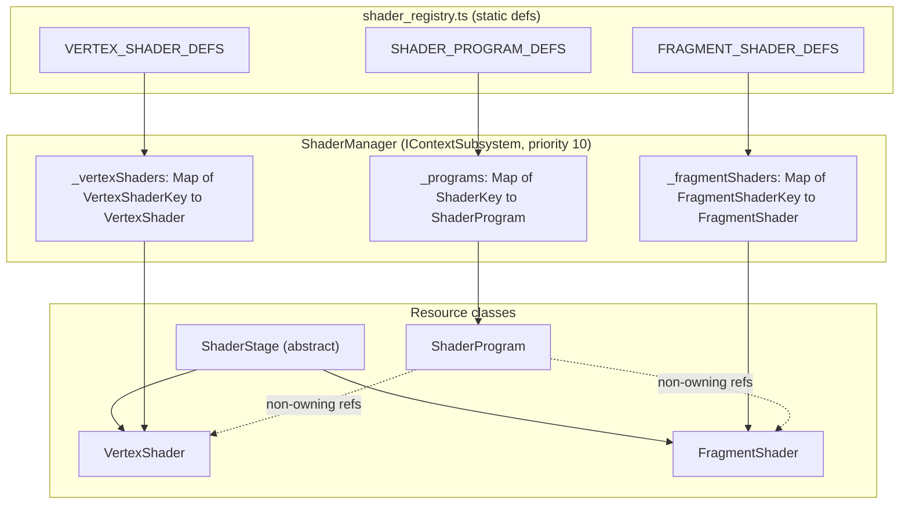

# Shader Stage Resources Design (Reusable Vertex & Fragment Shaders)

## 1. Overview & Goals

### Problem
Right now a [`ShaderProgram`](shader_program.ts) owns its GLSL sources. It compiles both stages privately inside `build()` and deletes the `WebGLShader` handles as soon as linking finishes. That causes three problems:
- **No reuse:** Each program recompiles its vertex shader, even when another program uses the exact same source. The engine needs far fewer vertex shaders (mesh transform, fullscreen ray, skybox, point sprites) than fragment shaders.
- **1:1 coupling:** [`shader_manager.ts`](shader_manager.ts) pairs one `.vert` with one `.frag` by convention. [`generate_shader_types.js`](../../../scripts/generate_shader_types.js) pairs files by basename to emit a combined `*Uniforms` type. A new fragment effect ends up needing a copy-pasted vertex shader.
- **Context restore cost:** On restoration, every program recompiles both of its stages.

### Goals
- **First-party stage resources:** An abstract `ShaderStage` base class wraps one `WebGLShader` and implements [`IWebGLResource`](../core/resource_types.ts). Concrete `VertexShader` and `FragmentShader` subclasses specialize it.
- **Compile once, link many:** Each stage compiles once per context, and every program that links it shares that compile.
- **Programs compose stages:** A `ShaderProgram` receives references to its stages. It does not own GLSL sources. It only links.
- **Independent lifetimes that mirror the GPU:** In WebGL, deleting a `WebGLShader` does not invalidate a program that has already been linked, and deleting a `WebGLProgram` does not touch its shaders. The wrappers behave the same way. Disposing a stage never disposes a program, and disposing a program never disposes a stage.
- **Independent keys:** `VertexShaderKey` and `FragmentShaderKey` are separate closed unions. `ShaderKey` stays the program key, so `Material.shaderKey` and `bindKey()` keep working.
- **Compile-time stage compatibility:** The generator emits per-file varying types without knowing which stages get paired. Pairing lives only in `ShaderProgramStageMap` (TypeScript), and a type-level assertion there turns mismatched varyings into `tsc` errors.
- **No back-compat aliases:** `ShaderProgramOptions.vertSource` / `fragSource`, `IShaderProgram.vertSource` / `fragSource`, `IShaderManager.shaderCount`, and the combined generated `<Pascal>Uniforms` types are removed outright.

### Non-Goals
- Uniform Buffer Objects for shared per-frame data. Uniforms remain per-program state.
- GLSL preprocessing, `#include`, or `#define` permutations.
- Consolidating vertex shaders. That is a follow-up (see §8). Stage keys start out 1:1 with today's files, so nothing changes visually.

---

## 2. Architecture



---

## 3. Types & Interfaces

### 3.1 Stage Types (`src/webgl/shaders/shader_stage_types.ts`)

```typescript
import type { IWebGLResource } from "../core/resource_types";
import type { VertexLayoutSpec } from "../geometry/vertex_layout_types";

/** Explicit WebGL stage enums (no magic numbers). */
export const ShaderStageType = {
    Vertex: WebGL2RenderingContext.VERTEX_SHADER,
    Fragment: WebGL2RenderingContext.FRAGMENT_SHADER,
} as const;
export type ShaderStageType = (typeof ShaderStageType)[keyof typeof ShaderStageType];
export type VertexStageType = typeof ShaderStageType.Vertex;
export type FragmentStageType = typeof ShaderStageType.Fragment;

export interface ShaderStageOptions {
    /** GLSL ES 3.00 source */
    source: string;
    /** Debug label used in diagnostics */
    label?: string;
}

/** Common contract for a single compiled GLSL stage wrapping one WebGLShader. */
export interface IShaderStage<TStage extends ShaderStageType = ShaderStageType> extends IWebGLResource {
    readonly stage: TStage;
    /** Retained after dispose so dependent programs can relink after context restoration. */
    readonly source: string;
    /** Driver compile log from the most recent failed compile, else null */
    readonly infoLog: string | null;
    readonly isDisposed: boolean;
    /** Native handle, or null if compile failed, context lost, or disposed */
    getShader(): WebGLShader | null;
    onDispose(callback: () => void): () => void;
}

export interface IVertexShader extends IShaderStage<VertexStageType> {
    /** Attribute layout lazily parsed from `layout(location = N) in` declarations */
    readonly vertexLayout: VertexLayoutSpec;
}

export interface IFragmentShader extends IShaderStage<FragmentStageType> {}
```

`stage` is typed as a literal, so `IVertexShader` and `IFragmentShader` can't be assigned to each other.

> `ShaderStageType` is a runtime `const`. If the types-only file rule requires it, put it in `shader_stage_constants.ts` and import its `typeof` into `shader_stage_types.ts`, following the existing pattern in [webgl_constants.ts](../core/webgl_constants.ts) and [webgl_constants_types.ts](../core/webgl_constants_types.ts).

### 3.2 Classes
- **`abstract class ShaderStage<TStage>`** ([shader_stage.ts](shader_stage.ts)): owns the handle, compile, `infoLog`, dispose, `onDispose`, and the context lost/restored hooks. Its constructor is `protected constructor(contextManager, stage: TStage, options)`, and it compiles eagerly. All state is `private`, with public read-only getters (per [typescript_guidelines.md §7](../../project_guidelines/typescript_guidelines.md)).
- **`class VertexShader extends ShaderStage<VertexStageType>`** ([vertex_shader.ts](vertex_shader.ts)): adds `vertexLayout`, computed lazily via `parseVertexLayoutFromGLSL(source)` and cached.
- **`class FragmentShader extends ShaderStage<FragmentStageType>`** ([fragment_shader.ts](fragment_shader.ts)): no extra members yet. It exists for nominal typing and as the place for future fragment-only features.

### 3.3 Program Types (`shader_program_types.ts`, revised)

```typescript
export interface ShaderProgramOptions {
    vertex: IVertexShader;
    fragment: IFragmentShader;
    label?: string;
    samplers?: Record<string, number>;
}

export interface IShaderProgram<TUniforms extends object = Record<string, unknown>> extends IWebGLResource {
    readonly label: string;
    readonly vertex: IVertexShader;
    readonly fragment: IFragmentShader;
    readonly isValid: boolean;
    readonly isDisposed: boolean;
    // getProgram(), setUniforms(), set*(), getUniformLocation() are unchanged
}
```

### 3.4 Keys, Maps & Compatibility (`shader_types.ts`, revised)

```typescript
export const VERTEX_SHADER_KEYS = ["unlit", "skybox", "galaxy_pinprick", "galaxy_orb", "galactic_cloud"] as const;
export type VertexShaderKey = (typeof VERTEX_SHADER_KEYS)[number];

export const FRAGMENT_SHADER_KEYS = ["unlit", "skybox", "galaxy_pinprick", "galaxy_orb", "galactic_cloud"] as const;
export type FragmentShaderKey = (typeof FRAGMENT_SHADER_KEYS)[number];

// The ShaderKey program unions and domain groupings stay as they are today.

/** Per-stage generated interfaces. */
export interface VertexUniformMap   { unlit: UnlitVertUniforms;  /* ... */ }
export interface FragmentUniformMap { unlit: UnlitFragUniforms;  /* ... */ }
export interface VertexOutputMap    { unlit: UnlitVertOutputs;   /* ... */ }
export interface FragmentInputMap   { unlit: UnlitFragInputs;    /* ... */ }

/** Single source of truth for pairing stages into programs. */
export interface ShaderProgramStageMap {
    unlit:           { vertex: "unlit";           fragment: "unlit" };
    skybox:          { vertex: "skybox";          fragment: "skybox" };
    galaxy_pinprick: { vertex: "galaxy_pinprick"; fragment: "galaxy_pinprick" };
    galaxy_orb:      { vertex: "galaxy_orb";      fragment: "galaxy_orb" };
    galactic_cloud:  { vertex: "galactic_cloud";  fragment: "galactic_cloud" };
}

export type ShaderUniformsOf<K extends ShaderKey> =
    VertexUniformMap[ShaderProgramStageMap[K]["vertex"]] &
    FragmentUniformMap[ShaderProgramStageMap[K]["fragment"]];

/** A fragment stage is compatible when every input it reads is a same-typed output of the vertex stage. */
export type StagesCompatible<V extends VertexShaderKey, F extends FragmentShaderKey> =
    FragmentInputMap[F] extends Pick<VertexOutputMap[V], keyof FragmentInputMap[F] & keyof VertexOutputMap[V]>
        ? (keyof FragmentInputMap[F] extends keyof VertexOutputMap[V] ? true : false)
        : false;

/** Program keys whose stages are incompatible (never when all programs are valid). */
export type IncompatibleShaderPrograms = {
    [K in ShaderKey]: StagesCompatible<ShaderProgramStageMap[K]["vertex"], ShaderProgramStageMap[K]["fragment"]> extends true ? never : K;
}[ShaderKey];

/** Type-only compile-time assertion; tsc errors and names the offending program keys. */
type AssertNoIncompatiblePrograms<T extends never> = T;
export type ShaderStageCompatibilityCheck = AssertNoIncompatiblePrograms<IncompatibleShaderPrograms>;

export interface ShaderStageDef { source: string; label?: string; }

export interface ShaderProgramDef<K extends ShaderKey = ShaderKey> {
    vertex: ShaderProgramStageMap[K]["vertex"];
    fragment: ShaderProgramStageMap[K]["fragment"];
    label?: string;
    samplers?: Record<string, number>;
}
```

### 3.5 Manager Contract (`shader_manager_types.ts`, revised)

```typescript
export interface IShaderManager extends IContextSubsystem {
    readonly activeShader: ShaderProgram<never> | null;
    readonly activeProgram: WebGLProgram | null;
    readonly programCount: number;        // replaces shaderCount
    readonly vertexShaderCount: number;
    readonly fragmentShaderCount: number;

    /** Stage factories: cached per key; fall back to registry defs when `def` is omitted. */
    getOrCreateVertexShader(key: VertexShaderKey, def?: ShaderStageDef): VertexShader;
    getOrCreateFragmentShader(key: FragmentShaderKey, def?: ShaderStageDef): FragmentShader;
    getVertexShader(key: VertexShaderKey): VertexShader | null;
    getFragmentShader(key: FragmentShaderKey): FragmentShader | null;

    /** Program factory: resolves stages by key (compiling on demand), then links. */
    getOrCreate<K extends ShaderKey>(key: K, def?: ShaderProgramDef<K>): ShaderProgram<ShaderUniformsOf<K>>;
    get<K extends ShaderKey>(key: K): ShaderProgram<ShaderUniformsOf<K>> | null;
    has(key: ShaderKey): boolean;

    bind<TUniforms extends object = never>(shader: ShaderProgram<TUniforms> | null): void;
    bindKey<K extends ShaderKey>(key: K): ShaderProgram<ShaderUniformsOf<K>>;
    bindProgram(program: WebGLProgram | null): void;
    unbind(): void;
}
```

The `IWebGLContextManager.getOrCreateShader` / `getShader` facades take the same signatures as `getOrCreate` / `get`.

---

## 4. Module Layout

- **New** `shader_stage_types.ts`: stage types and interfaces (plus a constants file if needed, see the note in §3.1).
- **New** `shader_stage.ts`: abstract base `ShaderStage`.
- **New** `vertex_shader.ts`, `fragment_shader.ts`: concrete stages.
- **New** `shader_registry.ts`: `VERTEX_SHADER_DEFS`, `FRAGMENT_SHADER_DEFS`, and `SHADER_PROGRAM_DEFS` (with `satisfies { [K in ShaderKey]: ShaderProgramDef<K> }`). The GLSL imports move here from `shader_manager.ts`.
- **Revised** `shader_compiler.ts`: keeps `compileShader()` and adds `linkProgram(gl, vs, fs, label): WebGLProgram | null`. It links, checks `LINK_STATUS`, logs failures, and always detaches both shaders. It deletes the program on failure and never deletes shaders.
- **Revised** `shader_program.ts`, `shader_program_types.ts`, `shader_manager.ts`, `shader_manager_types.ts`, `shader_types.ts`, `../core/context_manager.ts`, `../core/context_manager_types.ts`, `../../testing/mocks/mock_context_manager.ts`.
- **Revised** `scripts/generate_shader_types.js` (§6).

---

## 5. Procedures & Algorithms

### 5.1 Stage Compile (`ShaderStage`)
1. Construction stores `stage`, `source`, `label`, and `contextManager`, then calls `compile()`.
2. `compile(gl)`: return false if there is no context or the context is lost. Otherwise create the shader, set its source, and compile it (via `compileShader`, extended so the info log can be captured).
3. On success, store the handle and set `infoLog = null`. On failure, set `shader = null`, store the info log, and leave `isValid = false`. Construction never throws on compile errors.

### 5.2 Program Acquisition (`ShaderManager.getOrCreate`)
1. If `_programs` already has the key, return it.
2. Resolve `def` (the argument, otherwise `SHADER_PROGRAM_DEFS[key]`). Throw a descriptive error if neither exists, or if no context is attached or initialized.
3. `vertex = getOrCreateVertexShader(def.vertex)` and `fragment = getOrCreateFragmentShader(def.fragment)`. Each one hits the cache or compiles.
4. `program = new ShaderProgram(contextManager, { vertex, fragment, label, samplers })`.
5. `program.onDispose(() => { unbind if active; _programs.delete(key); })`.
6. Cache the program and return it. No listeners are registered between stages and programs.

Stage acquisition works the same way: cache lookup, then the registry def, then `new VertexShader` / `new FragmentShader`, then `stage.onDispose(() => registry.delete(key))`.

### 5.3 Program Link (`ShaderProgram.build`)
1. If either stage is disposed **at construction**, throw an error. This mirrors attaching a deleted shader, which is a programmer error.
2. Resolve each stage handle:
   - If `stage.getShader()` returns a live handle, use it.
   - Otherwise, if the stage is disposed (only possible during a later relink), compile a **transient** handle from `stage.source`.
   - Otherwise (stage alive but its compile failed), log `[label] cannot link: <stage label> invalid` and return false.
3. `program = linkProgram(gl, vs, fs, label)`.
4. Delete any transient handles, whether linking succeeded or failed.
5. If linking failed, return false. Otherwise store the handle and run `reflectActiveUniforms()` (unchanged).

### 5.4 Independent Disposal (mirrors the GPU)
- **`stage.dispose()`:** returns immediately if already disposed. Otherwise it marks the stage disposed, calls `gl.deleteShader(handle)` if the context is alive, nulls the handle, and fires `onDispose`, which evicts the stage from its registry. Programs already linked against it stay valid and bound. `source` is kept.
- **`program.dispose()`:** unchanged. It deletes the `WebGLProgram`, unbinds if active, and evicts itself. Its stages stay alive and cached.
- **Re-acquisition:** calling `getOrCreateVertexShader(key)` after disposing that stage creates a new instance. Existing programs keep their reference to the old, disposed wrapper and relink from its `source` when needed.
- **`ShaderManager.destroy()`:** unbinds, disposes every program, then every fragment stage, then every vertex stage, and clears all maps. The order doesn't matter for correctness because each `dispose` stands alone.

### 5.5 Context Loss & Restoration
1. **`onContextLost()`:** reset bind tracking. Forward `onContextLost()` to every registered stage and program. Each one nulls its handles and makes no driver calls.
2. **`onContextRestored(gl)`:** reset bind tracking, then:
   1. Recompile every registered vertex stage.
   2. Recompile every registered fragment stage.
   3. Relink every program and replay its cached uniforms.

   Programs that reference disposed stages relink through transient compiles (§5.3). All of this ordering happens inside `ShaderManager`, so the subsystem priority stays at 10.

### 5.6 Diagnostics
- `resourceCount` is programs + vertex stages + fragment stages.
- `details` has `programCount`, `vertexShaderCount`, `fragmentShaderCount`, `invalidStages: string[]` (labels of stages whose compile failed), and `currentShaderLabel`.

---

## 6. Codegen (`generate_shader_types.js`)

- **No pairing.** Each file is processed on its own. The generator never infers which vertex shader goes with which fragment shader.
- **`.vert` → `.vert.d.ts`** exports:
  - `default` source string
  - `<Pascal>VertUniforms` (from `uniform` declarations)
  - `<Pascal>VertOutputs`: the `out` varyings mapped to GLSL type string literals, e.g. `{ v_uv: "vec2"; v_normal: "vec3" }`
- **`.frag` → `.frag.d.ts`** exports:
  - `default` source string
  - `<Pascal>FragUniforms`
  - `<Pascal>FragInputs`: the `in` varyings, e.g. `{ v_uv: "vec2"; v_normal: "vec3" }`
- **Parsing rules:**
  - Skip lines starting with `layout(...)`. In vertex shaders those are attributes, and in fragment shaders they are color outputs.
  - Accept optional interpolation qualifiers (`flat`, `smooth`, `noperspective`, `centroid`) and precision qualifiers (`lowp`, `mediump`, `highp`).
  - Skip commented lines.
  - Interfaces with no members are emitted as `{}`.
- **Removed:** the combined `<Pascal>Uniforms` type. Composition happens in [shader_types.ts](shader_types.ts).
- **Unchanged:** sampler validation.

---

## 7. Trade-offs & Notes

- **VRAM:** Keeping compiled `WebGLShader` handles alive costs a little driver memory per stage. That is negligible at our scale, and it's what makes compiling once possible.
- **Per-program uniforms:** Sharing a vertex shader does not share uniform values. Every program still uploads its own camera matrices. A future UBO design would fix this.
- **Transient relink:** A program whose stage was disposed pays one extra compile, and only during context restoration. In return, lifetimes stay truly independent with no ref-counting.

---

## 8. Follow-up: Vertex Shader Consolidation

- **`unlit.vert` → `mesh_standard.vert`:** a generic position/normal/uv transform.
- **`galaxy_pinprick.vert` + `galaxy_orb.vert` → `galaxy_points.vert`:** identical attributes, uniforms, and varyings. Only the point-size and fade formulas differ, so they could merge behind a uniform.
- **`galactic_cloud.vert` → `fullscreen_ray.vert`:** a fullscreen view-ray quad.
- **`skybox.vert`:** stays dedicated.

Each of these only edits `VERTEX_SHADER_KEYS`, `VERTEX_SHADER_DEFS`, and `ShaderProgramStageMap`. The compatibility assertion catches any varying mismatch.

---

## 9. Test Plan

- **`shader_stage.test.ts`** (exercised through `VertexShader` / `FragmentShader`):
  - Compile success and failure: `isValid`, `infoLog`, `getShader()`.
  - `stage` literal values.
  - `dispose` is idempotent, calls `deleteShader`, keeps `source`, and fires `onDispose` / unsubscribe correctly.
  - Context lost nulls the handle with no driver calls. Context restored recompiles.
  - `VertexShader.vertexLayout` is parsed once and cached.
- **`shader_program.test.ts`:**
  - Links the provided stage handles without compiling.
  - Detaches stages but never deletes them.
  - Throws when constructed with a disposed stage.
  - Fails cleanly when a stage is invalid.
  - Disposing a stage after linking leaves the program valid.
  - Restore with a disposed stage does a transient compile and deletes it afterwards.
  - Restore replays the uniform cache.
- **`shader_manager.test.ts`:**
  - Two programs sharing a vertex key cause exactly one `VERTEX_SHADER` compile.
  - Counts per registry are correct.
  - Disposing a stage evicts only that stage. Programs remain.
  - Disposing a program evicts only that program. Stages remain.
  - Re-acquiring a disposed stage creates a new instance.
  - Restore order is vertex, then fragment, then programs.
  - `destroy()` clears everything.
  - The `bindKey` lazy path goes through the registry.
- **`shader_compiler.test.ts`:** `linkProgram` success, failure cleanup, always detaches, never deletes shaders.
